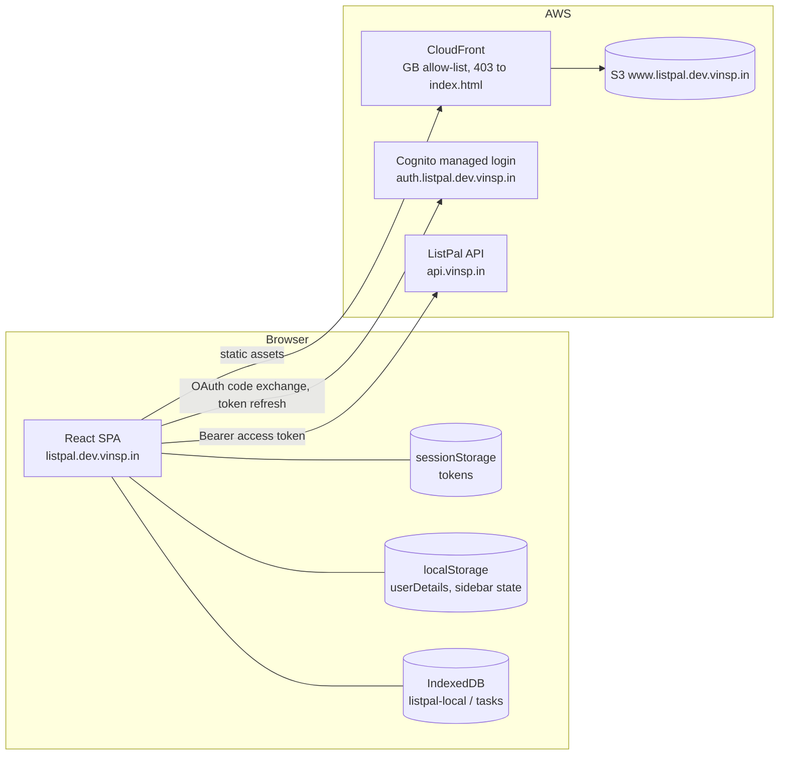
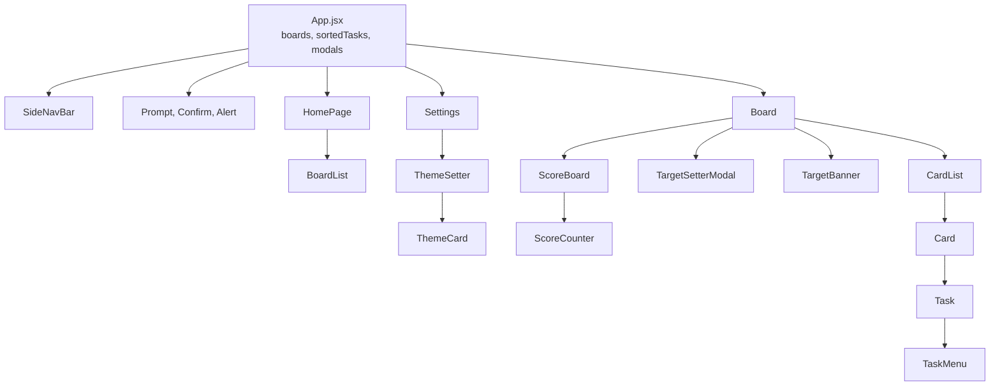
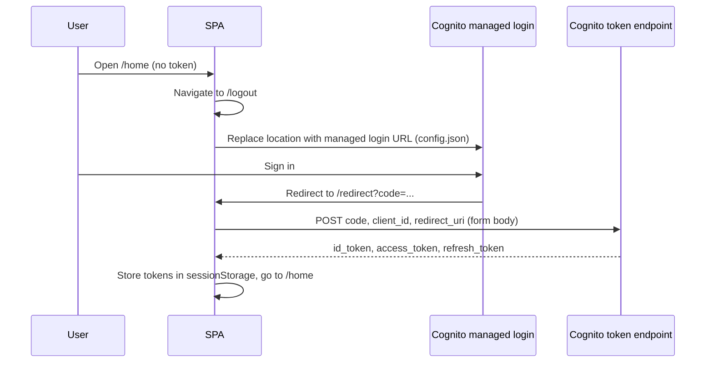
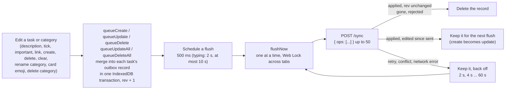
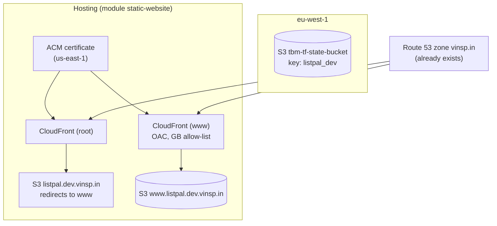
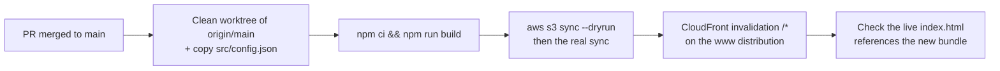

# ListPal Frontend: Architecture and Infrastructure

This document is a condensed map of the `listpal-frontend` repository. It is written so that a future reader (human or AI) can understand the app without reading every file. Facts were taken from the code on `main`. If the code has moved on, check the "Where to look" table before trusting the detail.

## 1. Summary

ListPal's frontend is a single-page React app. It shows a user's boards, lets them add and tick off tasks grouped by category, and displays scores against targets. The backend API is the source of truth. Task edits go into an outbox in IndexedDB and are pushed to the backend in batches, between half a second and ten seconds after an edit. Queued edits survive a reload and are retried with backoff until the server confirms them. The app needs the network to load a board, but edits made while offline are kept and sent later.

| Concern | Choice |
| --- | --- |
| Language | JavaScript (JSX) with one TypeScript entry file (`src/main.tsx`) |
| UI | React 18, `react-dom/client` |
| Build | Vite 5, `@vitejs/plugin-react` |
| Routing | `react-router-dom` 6, `BrowserRouter`, all routes declared in `App.jsx` |
| HTTP | `axios` against `https://api.vinsp.in` (hard-coded in `apiGatewayClient.js`) |
| Auth | Cognito managed login (OAuth code flow), token refresh through `@aws-sdk/client-cognito-identity-provider` |
| Local queue | IndexedDB database `listpal-local` (version 2), object store `outbox`, managed by `syncEngine.js` |
| Styling | Plain CSS, one file per component, theme colours as CSS custom properties |
| Charts | Victory (`victory`) |
| Hosting | S3 bucket `www.listpal.dev.vinsp.in` behind CloudFront, provisioned by Terraform |
| Environments | Effectively one. Local dev (`npm run dev`) talks to the same production API as the deployed site |

Tests run with `npm test` (Vitest). They cover the sync engine only (`src/utils/syncEngine.test.js`), using `fake-indexeddb` in place of the browser database.

## 2. Repository layout

```
listpal-frontend/
├── README.md                   Links only (Cognito, React libraries, CSS)
├── ARCHITECTURE.md             This file
├── CLAUDE.md                   Working rules for AI assistants
├── index.html                  Vite entry; mounts #root and loads src/main.tsx
├── package.json                Scripts: dev, build, preview, deploy, test
├── vite.config.ts              React plugin only
├── tsconfig.json               Type-checks src/ (only .ts and .tsx files, no allowJs)
├── tsconfig.node.json          Covers vite.config.ts
├── public/                     Static files served as-is (favicon, icons)
├── src/
│   ├── main.tsx                ReactDOM.createRoot; StrictMode is commented out
│   ├── App.jsx                 Shell: routes, boards state, starts the sync engine, modals, theme
│   ├── App.css                 Theme variables (:root) for four themes
│   ├── index.css               Global base styles and fonts (Circular)
│   ├── config.json             Region, Cognito pool and client IDs, login URLs
│   ├── fonts/                  Circular .otf files
│   ├── assets/                 PNG icons (icons8)
│   ├── utils/
│   │   ├── apiGatewayClient.js API wrapper: one function per backend route
│   │   ├── authService.js      Token exchange, refresh, storage of tokens
│   │   ├── localDBHelpers.js   openDB, a promise wrapper for indexedDB.open
│   │   ├── syncEngine.js       Task outbox: queueing, merging, batching, retries, sync status hook
│   │   ├── syncEngine.test.js  Vitest tests for the outbox
│   │   └── utils.js            JWT parsing, expiry check, percentages, dates, score periods, URL helpers
│   └── components/             Pages and widgets (one .jsx and usually one .css each)
├── terraform/
│   ├── main.tf                 The whole stack: one static-website module call
│   └── .terraform/             Provider and module cache (gitignored)
└── dist/                       Vite build output (gitignored)
```

`src/components/Header.jsx` is not rendered anywhere. `public/vite.svg`, `public/checked.svg` and `public/listpal-icon-bak.png` are not referenced from `src/` or `index.html`.

## 3. System architecture



The backend is described in `listpal-backend/ARCHITECTURE.md`. The frontend depends on it for every data read and write.

## 4. Pages and components

### 4.1 Routes

Routes are declared in `App.jsx`. The board route is a `/board/*` wildcard, and `getBoardIdFromUrl` in `utils.js` takes the board ID from the last URL segment. Every route except `/redirect` and `/logout` checks `isAuthenticated()` (which only tests that an access token is present in `sessionStorage`) and redirects to `/logout` when it is missing.

| Path | Component | Purpose | Backend calls |
| --- | --- | --- | --- |
| `/` | none | Redirects to `/home` | none |
| `/home` | `HomePage` | Greeting (from the ID token's `given_name`), week number, a random quote, the board list, and board creation | `POST /new-board` (via `BoardList`) |
| `/board/*` | `Board` | Tasks grouped by category, scores, targets, board emoji and name, delete, clear completed (an alert says so if there are none). The delete, clear and target icons each show a hover label. A deleted category card fades out, and the remaining cards slide into place when categories are added, removed or reordered | `GET /active-tasks`, `POST /board-emoji`, `POST /rename-board`, `POST /delete-board`, `POST /board-targets` (via `TargetSetter`) |
| `/settings` | `Settings` | Theme choice | `POST /user-theme` (via `ThemeCard`) |
| `/redirect` | `RedirectPage` | Receives the Cognito `code`, exchanges it for tokens, then goes to `/home` | Cognito token endpoint |
| `/logout` | `Logout` | Clears storage and sends the user to the managed login | none |
| `*` | none | `/home` when signed in, `/logout` when not | none |

### 4.2 Component tree



`Board` and `CardList` receive `sortedTasks`, `setSortedTasks`, `setBoards` and the modal setters as props. Components that write tasks import the queue functions from `syncEngine.js` directly. Nothing uses React context.

## 5. Authentication and session



Points to know:

- The redirect URI is chosen by `isDev`, which App.jsx derives from `process.env.NODE_ENV`. Local dev returns to `http://localhost:5173/redirect`. Production returns to `https://listpal.dev.vinsp.in/redirect`. Both must be registered as Cognito callback URLs.
- Before every API call, `apiGatewayClient.js` checks the access token's `exp` claim. If it has passed, `authService.refreshTokens` calls `InitiateAuth` with `REFRESH_TOKEN_AUTH` directly from the browser. There are no AWS credentials involved.
- If the refresh fails, `sessionStorage` is cleared. The next render sees no token and routes to `/logout`.
- Logout clears both `localStorage` and `sessionStorage` and then replaces the location with the managed login URL.
- The `Authorization` header is `Bearer <accessToken>`. The ID token is only read locally, to show the user's first name.

## 6. Data and state

The frontend owns no durable data. Everything persistent lives in the backend. The browser holds four kinds of state.

| Store | Key or shape | Written by | Lifetime |
| --- | --- | --- | --- |
| React state in `App.jsx` | `boards`, `sortedTasks` (tasks grouped by category), `userDetails`, `activeBoard`, modal config | Pages through props | Until a reload |
| IndexedDB `listpal-local` / `outbox` | One record per task with queued changes: `{ SK, boardID, kind, fields, rev }`, keyed on `SK` | `queueCreate`, `queueUpdate`, `queueDelete`, `queueUpdateAll`, `queueDeleteAll` in `syncEngine.js` | Until the server confirms the change. Survives reloads and logout |
| `sessionStorage` | `idToken`, `accessToken`, `refreshToken` | `authService.js` | Browser session |
| `localStorage` | `userDetails` (user record, mostly for the theme) | `App.jsx` after loading, `ThemeCard` on change | Until logout |
| `localStorage` | `sidebarIsOpen`, `sidebarBoardsMenuIsOpen` (`"true"` or `"false"`), read once as the initial React state | `App.jsx` whenever either value changes | Until logout |

`App.jsx` loads the user and the boards on start-up. `getBoards()` waits for an outbox flush first (at most `LOAD_FLUSH_TIMEOUT`, 3 s). Otherwise a tick queued just before a reload, or still in flight from the old page's keepalive request, could land after the scores were read. It parses `CategoryOrder` from a JSON string into an array for each board. Board pages then load their tasks separately. `getTasks` in `Board.jsx` first flushes the outbox (waiting at most 3 s), then calls `getActiveTasks(boardID)`, then lays any still-queued changes over the result with `overlayPending`.

## 7. Task writes and sync

Task edits do not call the API directly. Components call the queue functions in `src/utils/syncEngine.js` with only the fields that changed. The engine stores them in the IndexedDB outbox and sends them in batches to `POST /sync`. The engine is a module singleton, not React state. `App.jsx` calls `startSync` once.



How the outbox works:

- **One record per task.** `mergeRecord` combines changes:
  - create + update stays a create
  - update + update merges the fields
  - anything + delete becomes a delete
  - a delete ignores later edits, so the task cannot come back
- **Category actions are per-task changes.** Renaming a category, changing a card's emoji, deleting a category and clearing completed tasks queue one change per task with `queueUpdateAll` or `queueDeleteAll`, in a single transaction. They merge with any queued edits like any other change, so a pending edit can't undo a rename. They work offline too. A large category is sent over several batches of 50.
- **Create then delete.** A create that was never sent and is then deleted is dropped without a request. If the create may already have been sent (`maybeOnServer`), it becomes a delete instead.
- **Acks are matched by `rev`.** A record edited while its request was in flight is kept, so nothing typed during a sync is lost.
- **When flushes happen:** after the scheduled delay, when the browser comes back `online`, when the tab is hidden, and at start-up if anything is queued. On `pagehide`, `syncOpsKeepalive` sends the in-memory copy of the queue with `fetch(..., { keepalive: true })`. The records stay queued either way. The server treats a resend as a no-op.
- **Scores come from the server.** Ticking applies an optimistic change to `boards`, using `periodsContaining` from `utils.js` (the same UTC reset boundaries as the backend). The server changes the scores in the same transaction as the tick and returns them. `onBoardScores` writes those values into `boards`, but only once nothing else is queued for that board, so a stale value can't briefly reach the screen and re-trigger confetti.
- **Status indicator.** `useSyncStatus` exposes `{ pending, syncing, lastError }`. The bottom-right indicator in `Board.jsx` spins while changes are pending. While retrying, it gets a red ring and a red pill to its left ("Offline, retrying..." or "Couldn't save, retrying..."). The full error is in the indicator's tooltip. When queued edits reach the server after a spell offline, a green "Back online" pill shows for 3 s. `beforeunload` warns only while changes are pending and syncing is failing (`lastError` set). A healthy queue needs no warning, because reloads resend it. The browser can't tell a reload from a close, so a reload while offline still shows the prompt.

Edits that bypass the queue and call the API straight away:

| Action | Where | Endpoint |
| --- | --- | --- |
| Manually edit a score | `ScoreCounter.jsx` | `POST /board-scores` |
| Save category order | `DropdownMenu.jsx` (move up or down), `utils.js` (`updateCategoryOrder`, called from `Card.jsx` and `CardList.jsx`) | `POST /board-category-order` |
| Create, rename, change emoji, delete a board | `BoardList.jsx`, `Board.jsx` | `POST /new-board`, `/rename-board`, `/board-emoji`, `/delete-board` |
| Save targets | `TargetSetter.jsx` | `POST /board-targets` |
| Save theme | `ThemeCard.jsx` | `POST /user-theme` |

## 8. API client

`src/utils/apiGatewayClient.js` is the only place that builds URLs. Each exported function maps to one backend route.

| Function | Method and path | Backend status |
| --- | --- | --- |
| `getBoards` | `GET /boards` | Present |
| `getUser` | `GET /user` | Present |
| `getActiveTasks` | `GET /active-tasks` | Present |
| `syncOps` | `POST /sync` (silent, the sync engine reports failures) | Present |
| `syncOpsKeepalive` | `POST /sync` with `fetch` keepalive, used on `pagehide` | Present |
| `updateThemeAPI` | `POST /user-theme` | Present |
| `newBoardAPI` | `POST /new-board` | Present |
| `renameBoardAPI` | `POST /rename-board` | Present |
| `updateBoardEmojiAPI` | `POST /board-emoji` | Present |
| `updateBoardCategoryOrder` | `POST /board-category-order` | Present |
| `deleteBoard` | `POST /delete-board` | Present |
| `updateBoardScoresAPI` | `POST /board-scores` | Present |
| `updateBoardTargetsAPI` | `POST /board-targets` | Present |

Failures are handled the same way for every call. `apiGet` and `apiPost` log the error, call `window.alert(...)` (unless the call passes `silent`) and rethrow. A failed token refresh throws "Session expired" rather than returning an empty value. The backend returns real HTTP status codes (400, 403, 500) for errors, so axios rejects on them.

## 9. Styling and theming

- Each component imports its own CSS file. There is no CSS-in-JS, although `@emotion/react` is installed.
- `App.css` defines four themes on `:root`: `purple-haze` (the default), `granite`, `aqua-mentos` and `cherry-violet`. Each sets `-bg`, `-fg`, `-text-colour`, `-accent` and `-accent-2`.
- `applyTheme` in `App.jsx` copies the user's theme into the generic variables `--background`, `--foreground`, `--text-colour`, `--accent` and `--accent-2` on `document.documentElement`. Components read the generic names.
- `App.css` sets `color-scheme: dark`. `index.css` has a light-scheme media query that only changes text colour.
- Fonts are the Circular family from `src/fonts/`, loaded with `@font-face` in `index.css`.
- Layout is responsive. `App.jsx` treats a window narrower than 650 px as mobile (`MOBILE_BREAKPOINT`), and the side bar behaves differently in that mode.

## 10. Infrastructure



Key points:

- All infrastructure is one module call in `terraform/main.tf`: `static-website` from a private GitHub repository over SSH, pinned to `static-website-v0.0.15`.
- Project name `listpal-dev`, domain `listpal.dev.vinsp.in`, root zone `vinsp.in`, allowed locations `["GB"]`, query strings forwarded.
- Terraform state is in S3 bucket `tbm-tf-state-bucket` in `eu-west-1`, key `listpal_dev`. The backend uses a different key (`listpal-infra`) in the same bucket. No lock table is configured.
- Provider `hashicorp/aws ~> 5.35.0`, region `eu-west-2`. Required Terraform version `>= 0.14.0`.
- CloudFront maps a 403 from S3 to `/index.html` with status 200. This is what lets deep links such as `/board/<id>` work after a refresh.
- The S3 bucket is private and reached only through CloudFront origin access control.
- The root domain redirects to `www`.

## 11. Deployment and local development

There is no pipeline. Releases are run by hand with the `/deploy` skill in `.claude/skills/deploy/SKILL.md`. It builds a clean worktree of `origin/main`, syncs `dist/` to the bucket and invalidates CloudFront. It asks before each step that changes something.



```sh
npm install
npm run dev        # Vite on 0.0.0.0:5173, uses localhost redirect URI
npm run build      # type-checks src/*.ts(x), then bundles to dist/
npm test           # Vitest
```

Things to know:

- `npm run deploy` still exists, but it builds the working tree and does not invalidate CloudFront. The cache TTL is one year, so use the deploy skill instead.
- Local dev signs in through the same Cognito pool and calls the same production API. Changes that write data affect the live Dev data.
- Terraform changes are applied from `terraform/` with `terraform plan` and `terraform apply`, using AWS credentials for the target account.

## 12. Persistence and recovery

The frontend has no backups of its own. Everything users care about is in the backend, so the backup and restore procedure is documented in `listpal-backend/ARCHITECTURE.md` (section 9).

Unsynced task edits are kept in the IndexedDB outbox across reloads, logouts and network failures, and are sent once the app is open and signed in again. They are lost only if the browser's site data is cleared, or if the server rejects them (for example, edits to a board that has since been deleted).

`localStorage` and `sessionStorage` are cleared on logout, so the user has to sign in again. This also resets the sidebar and its Boards menu to closed.

## 13. Quality and security observations

These are things a reader should know before changing the app. They are not fixed in the code.

- **The API address is hard-coded.** `apiGatewayClient.js` sets `https://api.vinsp.in`. There is no way to point the app at a different API without editing source.
- **Tokens sit in `sessionStorage`.** Any script on the page can read them. The managed login URLs in `config.json` carry no `code_challenge`, so the code exchange is not PKCE-protected.
- **Dialogs for errors.** `apiGet` and `apiPost` call `window.alert`, which blocks the page. Task sync is the exception: it is silent and shows its state on the sync indicator.
- **Keepalive and CORS.** The `pagehide` flush is best effort. Browsers may refuse a keepalive request that needs a CORS preflight. Nothing is lost if it fails, because the outbox is flushed on the next load.
- **Old tabs block the database upgrade.** A tab still running a build from before the outbox (IndexedDB version 1) does not close its connection, so a new tab's upgrade waits until that tab is closed or reloaded.
- **Only `main.tsx` is type-checked.** The rest is JavaScript and `tsc` does not look at it, so `npm run build` gives little assurance about most of the code.
- **StrictMode is off.** `main.tsx` has `<React.StrictMode>` commented out, so React's development double-render checks do not run.
- **Unused dependencies.** `react-select`, `react-dropdown` and `@emotion/react` are not imported anywhere.
- **Category sort.** `setOrderedSortedTasks` sorts by `indexOf` in `CategoryOrder`. A category missing from that array gets index -1 and sorts to the top. The saved order can hold stale or missing names. So every category action (new, rename, delete, move) builds the new order from the categories on screen, passes it to `setSortedTasks` and saves it, which also repairs the saved order. A board whose saved order is stale can still load with the missing categories at the top, until one of those actions runs.
- **Unused component and assets.** `Header.jsx` is not rendered. Several files in `public/` are not referenced.

## 14. Where to look

| I want to... | Go to |
| --- | --- |
| Add a page or change routing | `src/App.jsx` (routes), `src/components/` |
| Add or change a backend call | `src/utils/apiGatewayClient.js`, then the caller in `src/components/` |
| Change how edits are queued or synced | `src/utils/syncEngine.js` (and its tests), and the write points in `Task.jsx`, `TaskMenu.jsx`, `CardList.jsx`, `Card.jsx`, `Board.jsx` |
| Change scoring or completion dates | `src/components/Task.jsx` (`updateActiveTaskChecked`), `src/utils/utils.js` (`getNextMondayAt5AM`, `periodsContaining`, `calcPercents`). Server-side score rules are in `listpal-backend/src/task_sync.js` and `score_periods.js` |
| Change sign-in, tokens or logout | `src/utils/authService.js`, `src/utils/utils.js` (`isTokenExpired`), `src/components/RedirectPage.jsx`, `src/config.json` |
| Add a theme | `src/App.css` (new `:root` block), `src/components/ThemeSetter.jsx`, `src/components/ThemeCard.jsx` (`THEME_NAMES`) |
| Change hosting, domains or caching | `terraform/main.tf` (module inputs), `README.md` |
| Change the build or deploy | `package.json`, `vite.config.ts`, `tsconfig.json`, `.claude/skills/deploy/SKILL.md` |
| Change the API address or Cognito pool | `src/utils/apiGatewayClient.js`, `src/config.json` |
