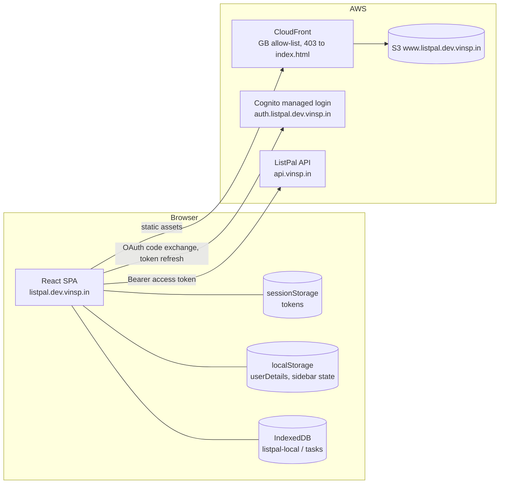
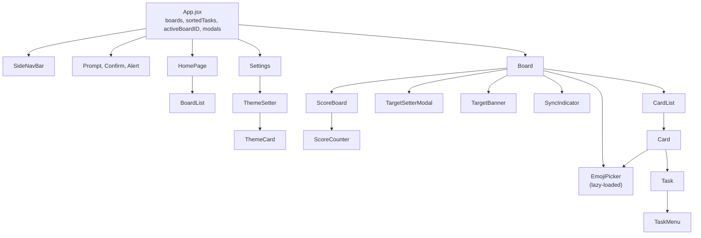
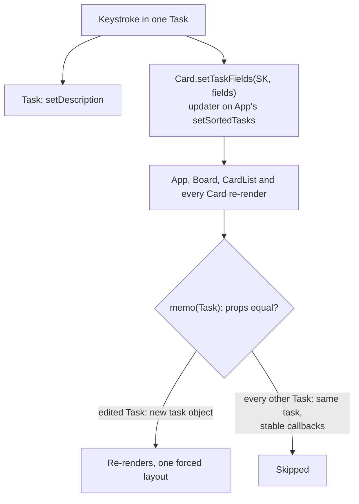
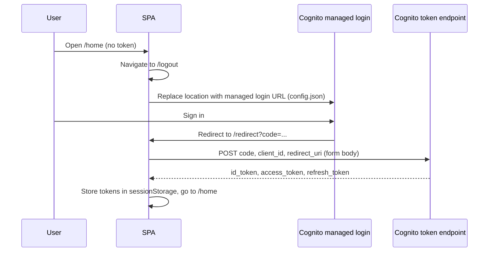
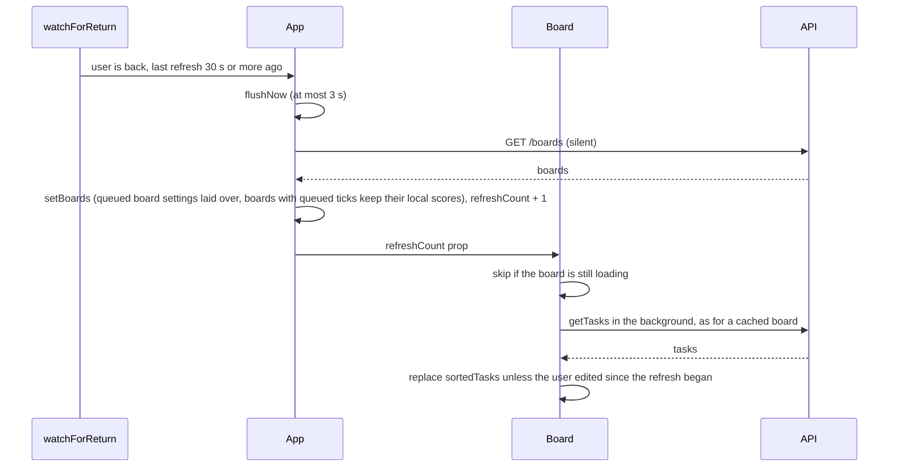
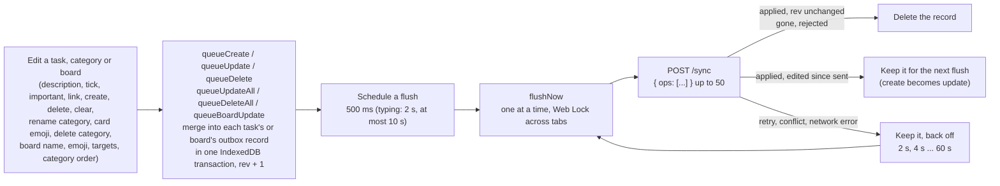
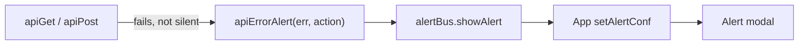
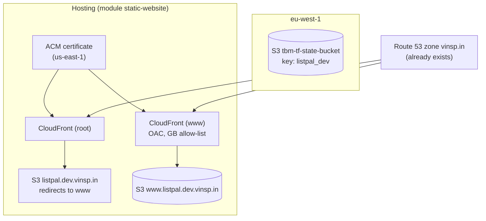
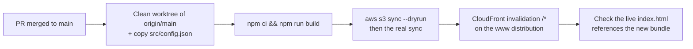

# ListPal Frontend: Architecture and Infrastructure

This document is a condensed map of the `listpal-frontend` repository. It is written so that a future reader (human or AI) can understand the app without reading every file. Facts were taken from the code on `main`. If the code has moved on, check the "Where to look" table before trusting the detail.

## 1. Summary

ListPal's frontend is a single-page React app. It shows a user's boards, lets them add and tick off tasks grouped by category, and displays scores against targets. The backend API is the source of truth. Task edits and board settings (name, emoji, targets, category order) go into an outbox in IndexedDB and are pushed to the backend in batches, between half a second and ten seconds after an edit. Queued edits survive a reload and are retried with backoff until the server confirms them. The app needs the network to load a board, but edits made while offline are kept and sent later. When the user comes back to a page left open, it fetches the boards and the shown board's tasks again, so changes made on another device show up without a reload.

| Concern | Choice |
| --- | --- |
| Language | JavaScript (JSX) with one TypeScript entry file (`src/main.tsx`) |
| UI | React 18, `react-dom/client` |
| Build | Vite 5, `@vitejs/plugin-react` |
| Routing | `react-router-dom` 6, `BrowserRouter`, all routes declared in `App.jsx` |
| HTTP | `axios` against `https://api.vinsp.in` (hard-coded in `apiGatewayClient.js`) |
| Auth | Cognito managed login (OAuth code flow), token refresh through the same OAuth token endpoint |
| Local queue | IndexedDB database `listpal-local` (version 2), object store `outbox`, managed by `syncEngine.js` |
| Styling | Plain CSS, one file per component, theme colours as CSS custom properties |
| Charts | Victory (`victory`) |
| Hosting | S3 bucket `www.listpal.dev.vinsp.in` behind CloudFront, provisioned by Terraform |
| Environments | Effectively one. Local dev (`npm run dev`) talks to the same production API as the deployed site |

Tests run with `npm test` (Vitest). They cover the sync engine (`src/utils/syncEngine.test.js`), using `fake-indexeddb` in place of the browser database, the API error messages (`src/utils/apiErrors.test.js`) and the refresh-on-return triggers (`src/utils/refreshOnReturn.test.js`).

## 2. Repository layout

```
listpal-frontend/
├── README.md                   Links only (Cognito, React libraries, CSS)
├── ARCHITECTURE.md             This file
├── CLAUDE.md                   Working rules for AI assistants
├── index.html                  Vite entry; mounts #root and loads src/main.tsx
├── package.json                Scripts: dev, build, preview, deploy, test
├── vite.config.ts              React plugin only
├── tsconfig.json               Type-checks src/ (only .ts and .tsx files, no allowJs)
├── tsconfig.node.json          Covers vite.config.ts
├── public/                     Static files served as-is (favicon, icons)
├── src/
│   ├── main.tsx                ReactDOM.createRoot; StrictMode is commented out
│   ├── App.jsx                 Shell: routes, boards state, starts the sync engine, modals, theme
│   ├── App.css                 Theme variables (:root) for four themes
│   ├── index.css               Global base styles and fonts (Circular)
│   ├── config.json             Region, Cognito pool and client IDs, login URLs
│   ├── fonts/                  Circular .woff2 files
│   ├── assets/                 PNG icons (icons8), plus a copy of the app icon for the target banner
│   ├── utils/
│   │   ├── alertBus.js         Lets non-React code raise the in-app Alert that App owns
│   │   ├── apiErrors.js        Turns a failed API call into a plain-language alert
│   │   ├── apiErrors.test.js   Vitest tests for those messages
│   │   ├── apiGatewayClient.js API wrapper: one function per backend route
│   │   ├── authService.js      Token exchange, refresh, storage of tokens
│   │   ├── localDBHelpers.js   openDB, a promise wrapper for indexedDB.open
│   │   ├── refreshOnReturn.js  Decides when a page left open is worth refetching (tab shown, focus, online, wake, idle)
│   │   ├── refreshOnReturn.test.js  Vitest tests for those triggers
│   │   ├── syncEngine.js       Task and board settings outbox: queueing, merging, batching, retries, sync status hook and getter
│   │   ├── syncEngine.test.js  Vitest tests for the outbox
│   │   └── utils.js            JWT parsing, expiry check, percentages, dates, score periods, URL helpers
│   └── components/             Pages and widgets (one .jsx and usually one .css each)
├── terraform/
│   ├── main.tf                 The whole stack: one static-website module call
│   └── .terraform/             Provider and module cache (gitignored)
└── dist/                       Vite build output (gitignored)
```

`src/components/Header.jsx` is not rendered anywhere. `public/vite.svg`, `public/checked.svg` and `public/listpal-icon-bak.png` are not referenced from `src/` or `index.html`.

## 3. System architecture



The backend is described in `listpal-backend/ARCHITECTURE.md`. The frontend depends on it for every data read and write.

## 4. Pages and components

### 4.1 Routes

Routes are declared in `App.jsx`. The board route is a `/board/*` wildcard, and `getBoardIdFromUrl` in `utils.js` takes the board ID from the last URL segment. Every route except `/redirect` and `/logout` checks `isAuthenticated()` (which only tests that an access token is present in `sessionStorage`) and redirects to `/logout` when it is missing.

| Path | Component | Purpose | Backend calls |
| --- | --- | --- | --- |
| `/` | none | Redirects to `/home` | none |
| `/home` | `HomePage` | Greeting (from the ID token's `given_name`), week number, a random quote, the board list, and board creation | `POST /new-board` (via `BoardList`) |
| `/board/*` | `Board` | Tasks grouped by category, scores, targets, board emoji and name, delete, clear completed (an alert says so if there are none). The delete, clear and target icons each show a hover label. A deleted category card fades out, and the remaining cards slide into place when categories are added, removed or reordered. Within a card, ticked tasks come first, in the order they were ticked, then unticked tasks in `CreatedDate` order. Tasks edit like lines in a notes app. Enter splits a task at the caret: the text after it (less any selection) moves into a new task directly below, with the caret at its start. Enter at the very start of a task instead adds an empty task above, so the task keeps its link and importance. A new task goes between its neighbours by taking a `CreatedDate` halfway between theirs (fractional if need be), as the server ignores `CreatedDate` on update and neighbours can't be renumbered; above the first unticked task it takes 1 ms before it. The "new task..." button, and Enter at the end of the last unticked task, add at the bottom. Backspace at the start of a task joins it onto the end of the unticked task above, and Delete at the end pulls the task below up into it, with the caret at the join. The upper task keeps its importance and link, a link on the lower one moves up if the upper has none, and a join between two tasks that both have links is refused. Backspace in an empty task deletes it and moves the caret to the end of the unticked task above, or to the start of the one below if it was the first; Delete in an empty task does the same, preferring the task below. Delete Task in a task's menu deletes it at once, with no confirmation. Deleting a category's only task, by key or from its menu, asks whether to delete the whole category instead, and confirming fades the card out as the category menu's delete does. The last unticked task beside ticked ones can't be deleted: one with text is blanked, and an empty one shows an alert. Shift+Enter is left to the textarea, so it adds a line break within the task. Cmd+Enter ticks the task and moves the caret to the start of the unticked task below, or the end of the one above if it was the last; ticking a card's last unticked task adds an empty one, which takes focus. Confetti for a target met by a tick, by click or Cmd+Enter, bursts from the ticked task's checkbox where the task ends up, so it stays in view when the page scrolls to follow the task. Any other burst, such as one from lowering a target, starts at the mouse pointer. Each target pins its own burst to where it started, so a second target hit while the first burst plays gets its own origin, not the first one's. Enter in a category title moves the caret to the start of the card's first unticked task, and Escape in a title or task leaves it; both save a title rename through blur. These keys do nothing to the list while an input method is composing. Tasks slide into place (300 ms) when one is ticked or unticked, so a newly ticked task visibly moves up to the bottom of the ticked tasks. Adding or deleting a task has no slide: the task appears or vanishes at once and the tasks below jump into place, as sliding them would draw them over the new task or leave a gap where the old one was | `GET /active-tasks`, `POST /delete-board`, `POST /board-scores` (via `ScoreCounter`). Name, emoji, targets and category order go through the outbox to `POST /sync` |
| `/settings` | `Settings` | Theme choice | `POST /user-theme` (via `ThemeCard`) |
| `/redirect` | `RedirectPage` | Receives the Cognito `code`, exchanges it for tokens, then goes to `/home`. Its ListPal logo is centred on the viewport, as is the loader `HomePage` shows next (`<Loader fullScreen />`), so the handover doesn't shift whatever the sidebar's width | Cognito token endpoint |
| `/logout` | `Logout` | Clears storage and sends the user to the managed login | none |
| `*` | none | `/home` when signed in, `/logout` when not | none |

### 4.2 Component tree



`Board` and `CardList` receive `sortedTasks`, `setSortedTasks`, `setBoards` and the modal setters as props. `setSortedTasks` is App's `setOrderedSortedTasks`: it keeps one identity across renders, takes a value or an updater function, and orders the categories by the active board's `CategoryOrder` unless the caller passes an order. `App` holds the active board as an ID, which `Board`, `SideNavBar` and `BoardList` set, and derives the board object from `boards` for the side bar's highlight and its collapsed "Boards" link. `Board` shows its name, emoji, page title and delete confirmation straight from its entry in `boards`, without copying them into state, so a rename or emoji change shows through `setBoards` alone. Every change to `sortedTasks` builds a new object, a new array for each category it touches and a new object for each task it changes. Nothing is changed in place, because `Card`'s ordered list and memoised children compare by reference and would miss an in-place change. Components that write tasks import the queue functions from `syncEngine.js` directly. Nothing uses React context.

`Task` is wrapped in `memo`, and each Task receives only its own `task` object plus props that keep one identity, so an edit re-renders the edited Task and no other. Every Task renders a textarea, so this matters on a large board. `Card` owns the task-level callbacks and passes them down:

- `setTaskFields(SK, fields)` merges fields into one task in local state. The caller queues the sync.
- `addTask(besideSK, { above, description })` creates a task directly below `besideSK` (or above it, with `above`) when given, or at the bottom (the "new task..." button). A split passes the text after the caret as `description`.
- `joinTask(SK, withAbove)` joins a task with the unticked task above or below it, and returns whether it did.

A new task, or one whose text a join changed, needs the caret placed after React has written its text, as React moves the caret to the end whenever it changes a textarea's value. `Card` leaves a request in `focusRequestRef` (`{ SK, caret, description }`), and the matching `Task` acts on it in a layout effect once it shows that text. A request with `caret: null` stops a new empty task above the caret from taking focus, which empty tasks otherwise do on mount.
- `toggleTaskChecked(SK, isChecked)` ticks or unticks, applies the optimistic score change, and adds an empty task when the last unticked one is ticked.
- `deleteTask(SK, title)` wraps `CardList.handleDeleteTask`. For the category's only task it blurs the task, so keys typed behind the modal can't reach it, and asks to delete the category instead.

They write through `setSortedTasks` updaters, so they always start from the latest state. Where a decision drives a side effect (whether to create the empty task, which score periods to reduce), `Card` reads its latest tasks from a ref. `CardList.handleDeleteTask` works the same way, reading `sortedTasks` from a ref to keep the last unticked task beside ticked ones. `Card` itself still re-renders on every edit, because `sortedTasks` is one object. The category-level handlers (rename, emoji, delete, move) are not passed to Tasks, so they read `sortedTasks` from props.



## 5. Authentication and session



Points to know:

- The redirect URI is chosen by `isDev`, which App.jsx derives from `process.env.NODE_ENV`. Local dev returns to `http://localhost:5173/redirect`. Production returns to `https://listpal.dev.vinsp.in/redirect`. Both must be registered as Cognito callback URLs.
- Before every API call, `apiGatewayClient.js` checks the access token's `exp` claim. If it has passed, `authService.refreshTokens` POSTs `grant_type=refresh_token` to the token endpoint, as a form body like the code exchange. Calls that find the token expired at the same moment share one refresh. The response has no refresh token (rotation is off), so the stored one is kept. There is no AWS SDK in the bundle and no AWS credentials involved.
- If the refresh fails, `sessionStorage` is cleared. The next render sees no token and routes to `/logout`.
- Logout clears both `localStorage` and `sessionStorage` and then replaces the location with the managed login URL.
- The `Authorization` header is `Bearer <accessToken>`. The ID token is only read locally, to show the user's first name.

## 6. Data and state

The frontend owns no durable data. Everything persistent lives in the backend. The browser holds five kinds of state.

| Store | Key or shape | Written by | Lifetime |
| --- | --- | --- | --- |
| React state in `App.jsx` | `boards`, `sortedTasks` (tasks grouped by category), `userDetails`, `activeBoardID` (the board object is derived from `boards`), modal config | Pages through props | Until a reload |
| Module state in `boardCache.js` | The last `sortedTasks` shown for each board, keyed on board ID | `Board.jsx` whenever the shown board's `sortedTasks` changes, except the empty board shown behind a load error; dropped when the board is deleted | Until a reload or logout (which reloads). Survives Board unmounting |
| IndexedDB `listpal-local` / `outbox` | One record per task or board with queued changes: `{ SK, boardID, kind, fields, rev }`, keyed on `SK`. A board record has `SK` and `boardID` both set to the board ID, `kind: "update"`, and only board settings in `fields` | `queueCreate`, `queueUpdate`, `queueDelete`, `queueUpdateAll`, `queueDeleteAll`, `queueBoardUpdate` in `syncEngine.js` | Until the server confirms the change. Survives reloads and logout |
| `sessionStorage` | `idToken`, `accessToken`, `refreshToken` | `authService.js` | Browser session |
| `localStorage` | `userDetails` (user record, mostly for the theme) | `App.jsx` after loading, `ThemeCard` on change | Until logout |
| `localStorage` | `sidebarIsOpen`, `sidebarBoardsMenuIsOpen` (`"true"` or `"false"`), read once as the initial React state | `App.jsx` whenever either value changes | Until logout |

`App.jsx` loads the user and the boards on start-up. `getBoards()` waits for an outbox flush first (at most `LOAD_FLUSH_TIMEOUT`, 3 s). Otherwise a tick queued just before a reload, or still in flight from the old page's keepalive request, could land after the scores were read. It reads the outbox before the flush and again after `GET /boards`, parses `CategoryOrder` from a JSON string into an array for each board, and lays queued board settings over the result with `applyPendingBoards`, so a rename, emoji, target or category order change that hasn't reached the server yet still shows after a reload. `SideNavBar` isn't rendered until this first load settles (`initialLoadDone`, kept apart from `isLoading`, which `Board` turns back on for each board switch), so it fades in with the page content rather than beside the loader, over 250 ms ease-out like the content's `fadeUp-animation`. Board pages then load their tasks separately, in `getTasks` in `Board.jsx`:

1. It reads the outbox (`readPending`).
2. It calls `getActiveTasks(boardID)` and `flushNow` (waiting at most 3 s) in parallel.
3. It reads the outbox again, merges the two reads with `mergePending`, and lays them over the fetched tasks with `applyPending`. A change settled by that flush is still in the first read, so it shows even if the fetch read the server before the flush landed. Queued changes hold whole field values, so applying one the server already has changes nothing.

Each board switch is numbered (`loadCount`), and only the latest load's response is applied.

Switching to a board shown before in this session is instant. A layout effect puts the cached copy from `boardCache.js` on screen before the browser paints, with no loader, and `getTasks` then runs in the background: no loader, no alert on failure, and the cached copy stays if it fails. When the fresh copy arrives it replaces the cached one, unless the user edited the board in the meantime. Edits always produce a new `sortedTasks` object, so Board compares against the value the cached copy landed as; those edits are queued, so nothing is lost by keeping them. Because a fresh copy can replace tasks in place, `Task` derives its tick from `task.CompletedDate` rather than keeping its own state, and `Card` follows its first task's `Emoji`.

### 6.1 Refresh on return

A page left open on one device goes stale when the user edits the same boards on another. `watchForReturn` in `refreshOnReturn.js`, started once by `App`, calls back when the user is likely to be looking at the page again:

- the tab becomes visible (`visibilitychange`)
- the window regains focus
- the browser comes back `online`
- the computer wakes from sleep: a 15 s interval notices when far more than 15 s has passed between ticks, because a laptop can wake with the tab visible and focused and fire no event
- the first pointer or key input after 5 minutes without any, for a laptop left open on the board, which may never hide the tab or lose focus

Each trigger is ignored while the tab is hidden, and only one refresh runs per 30 s (`STALE_AFTER`), so flicking between tabs doesn't refetch every time. Nothing polls, so a tab nobody is looking at makes no requests. A refresh costs one `GET /boards` and, on a board page, one `GET /active-tasks`.



Points to know:

- Boards land before `refreshCount` moves, so the tasks are sorted by the latest `CategoryOrder`.
- The task refetch reuses the background load of a cached board: the board as it stood when the refresh began is the baseline, and an edit made while the request is in flight keeps the local copy. That edit is queued, so nothing is lost, but the remote changes then wait for the next refresh.
- A board with task changes still queued on this device keeps its own `WScore`, `MScore` and `YScore`, because the server's scores don't include them yet. A queued board settings change doesn't count here, as it can't move scores.
- Queued board settings are laid over the fetched boards with `applyPendingBoards`, using the same two outbox reads, so a refresh that lands mid-request can't put an old name or category order back on screen.
- A target met on another device shows its star but no confetti or banner, the same as loading a board that is already over target. `ScoreCounter` treats a score change that arrives with a new `refreshCount` as a load rather than a crossing. It updates its copy of `refreshCount` in a separate effect, so a refresh that changes nothing doesn't bulge the counters.
- Failures are logged and ignored: what is on screen stays, and the next trigger after 30 s tries again.
- The user's theme and name are not refetched.

## 7. Task writes and sync

Task edits and board settings (name, emoji, targets, category order) do not call the API directly. Components call the queue functions in `src/utils/syncEngine.js` with only the fields that changed. The engine stores them in the IndexedDB outbox and sends them in batches to `POST /sync`. The engine is a module singleton, not React state. `App.jsx` calls `startSync` once.



How the outbox works:

- **One record per task.** `mergeRecord` combines changes:
  - create + update stays a create
  - update + update merges the fields
  - anything + delete becomes a delete
  - a delete ignores later edits, so the task cannot come back
- **Category actions are per-task changes.** Renaming a category, changing a card's emoji, deleting a category and clearing completed tasks queue one change per task with `queueUpdateAll` or `queueDeleteAll`, in a single transaction. They merge with any queued edits like any other change, so a pending edit can't undo a rename. They work offline too. A large category is sent over several batches of 50.
- **Board settings are one record per board.** `queueBoardUpdate` writes to a record keyed on the board ID, so two quick category moves or emoji picks merge into one op carrying the latest value, and nothing can arrive out of order. `CategoryOrder` is queued as the JSON string the server stores. Each caller updates `boards` first with a functional updater, so the change shows at once and works offline. The server applies board ops before task ops in a batch, and reports `gone` for a board deleted since. `applyPending` skips board records, and a queued board record doesn't hold back that board's confirmed scores.
- **Create then delete.** A create that was never sent and is then deleted is dropped without a request. If the create may already have been sent (`maybeOnServer`), it becomes a delete instead.
- **Acks are matched by `rev`.** A record edited while its request was in flight is kept, so nothing typed during a sync is lost.
- **When flushes happen:** after the scheduled delay, when the browser comes back `online`, when the tab is hidden, and at start-up if anything is queued. On `pagehide`, `syncOpsKeepalive` sends the in-memory copy of the queue with `fetch(..., { keepalive: true })`. The records stay queued either way. The server treats a resend as a no-op.
- **Scores come from the server.** Ticking applies an optimistic change to `boards`, using `periodsContaining` from `utils.js` (the same UTC reset boundaries as the backend). The server changes the scores in the same transaction as the tick and returns them. `onBoardScores` writes those values into `boards`, but only once nothing else is queued for that board, so a stale value can't briefly reach the screen and re-trigger confetti.
- **Status indicator.** `useSyncStatus` exposes `{ pending, syncing, lastError }`. Only `SyncIndicator.jsx` subscribes to it, so a status change re-renders the indicator and nothing else. Its bottom-right indicator, rendered by `Board`, spins while changes are pending. While retrying, it gets a red ring and a red pill to its left ("Offline, will sync later" or "Save hiccup, retrying..."). The tooltip explains the same in a little more detail; it never shows the raw error. When queued edits reach the server after a spell offline, a green "Back online, all caught up" pill shows for 3 s. The pills don't wrap and sit fixed at the bottom right, so keep their text short enough to fit a phone screen. `beforeunload` warns only while changes are pending and syncing is failing (`lastError` set). `App.jsx` registers that listener once and reads the status with `getSyncStatus()` when the page unloads, rather than subscribing. A healthy queue needs no warning, because reloads resend it. The browser can't tell a reload from a close, so a reload while offline still shows the prompt.

Edits that bypass the queue and call the API straight away:

| Action | Where | Endpoint |
| --- | --- | --- |
| Manually edit a score | `ScoreCounter.jsx` | `POST /board-scores` |
| Create, delete a board | `BoardList.jsx`, `Board.jsx` | `POST /new-board`, `/delete-board` |
| Save theme | `ThemeCard.jsx` | `POST /user-theme` |

## 8. API client

`src/utils/apiGatewayClient.js` is the only place that builds URLs. Each exported function maps to one backend route.

| Function | Method and path | Backend status |
| --- | --- | --- |
| `getBoards` | `GET /boards` (silent for a refresh on return) | Present |
| `getUser` | `GET /user` | Present |
| `getActiveTasks` | `GET /active-tasks` (silent for a background refresh of a cached board) | Present |
| `syncOps` | `POST /sync` (silent, the sync engine reports failures) | Present |
| `syncOpsKeepalive` | `POST /sync` with `fetch` keepalive, used on `pagehide` | Present |
| `updateThemeAPI` | `POST /user-theme` | Present |
| `newBoardAPI` | `POST /new-board` | Present |
| `deleteBoard` | `POST /delete-board` | Present |
| `updateBoardScoresAPI` | `POST /board-scores` | Present |

Failures are handled the same way for every call. `apiGet` and `apiPost` log the error, show the in-app `Alert` modal (unless the call passes `silent`) and rethrow. The app never uses `window.alert`, which would block the page. A failed token refresh throws an error with code `SESSION_EXPIRED` rather than returning an empty value. The backend returns real HTTP status codes (400, 403, 500) for errors, so axios rejects on them.

Each exported function passes an `action` such as "load your boards" or "save the score". `apiErrorAlert` in `apiErrors.js` combines it with the kind of failure, so the user reads "The internet seems to have wandered off, so we couldn't save the score" rather than "Request failed with status code 500". Each kind of failure gets its own light-hearted title (such as "Oops, that's on us 🛠️" for a 5xx), but the text always says what failed and what to do next. An expired session (or a 401) adds a "Sign in" button that goes to `/logout`, which clears the old tokens and opens the sign-in page. Queued task edits sit in IndexedDB, which logout leaves alone, so they are sent after signing in. Errors that are not from axios, such as a failed outbox read, get a general message rather than blaming the network.

The client is not a React component, so it reaches the modal through `alertBus.js`. `App` registers its `setAlertConf` as the one listener when it mounts.



Callers that already handle the failure (delete in `Board`) don't show a second alert of their own. `Board`'s task load passes `silent` and reports the failure itself, because the outbox reads in the same `try` can fail too. The `Alert` sits at `z-index: 3100`, above the targets modal at 3000.

`Prompt`, `Confirm` and `Alert` share `Prompt.css`. The box is 400px wide with a 30px title. Under 650px it fills the screen less a 16px gutter each side, and the title drops to 24px. Titles use `text-wrap: balance`, so one that must wrap splits into even lines rather than leaving its emoji alone on the second. Keep fixed titles short enough for one line on desktop (about 25 characters with an emoji).

## 9. Styling and theming

- Each component imports its own CSS file. There is no CSS-in-JS, although `@emotion/react` is installed.
- `App.css` defines four themes on `:root`: `purple-haze` (the default), `granite`, `aqua-mentos` and `cherry-violet`. Each sets `-bg`, `-fg`, `-text-colour`, `-accent` and `-accent-2`.
- `applyTheme` in `App.jsx` copies the user's theme into the generic variables `--background`, `--foreground`, `--text-colour`, `--accent` and `--accent-2` on `document.documentElement`. Components read the generic names.
- `App.css` sets `color-scheme: dark`. `index.css` has a light-scheme media query that only changes text colour.
- Fonts are the Circular family from `src/fonts/`, loaded with `@font-face` in `index.css` as WOFF2 with `font-display: swap`, so text shows at once in a fallback font while they download. Five faces are used: Book, Medium, Medium Italic, Bold and Black. The original `.otf` files were converted with fontTools and deleted; they remain in git history.
- Shared entrance and exit animations (`fadeIn`, `fadeUp`, `fadeOutDown`, `fadeInPure`) live in `TaskMenu.css` and last 150 to 250 ms. Animations honour `prefers-reduced-motion`: a rule at the end of `index.css` cuts every CSS animation and transition to 1 ms (not zero, so `animationend` still fires for category deletion), and `CardList.jsx` skips its card slide.
- Layout is responsive. `App.jsx` treats a window narrower than 650 px as mobile (`MOBILE_BREAKPOINT`), and the side bar behaves differently in that mode.
- The Important highlight on a task covers only the text, line by line. A textarea can't style its own text, so `Task.jsx` renders a hidden copy of the description (`.task-highlight-mirror`) behind the textarea and gives its inline `<span>` the background. The copy shares the `.task-textarea-box` class so it wraps identically. Any change to the textarea's font, padding or width must keep the two in step.
- A task's textarea grows to fit its text with no JavaScript. The wrapper is a one-cell grid holding the textarea and a hidden copy of the text (`.task-textarea-sizer`), so the row is as tall as the copy and the textarea stretches to match. This also tracks width changes that fire no resize event, such as the page's scroll bar appearing, which a script measuring on input and window resize missed and left the textarea showing a scroll bar.
- Up and Down move through the board's category titles and tasks as in a text editor, keeping the caret's horizontal position. Over a run of Up and Down presses the position is a goal column, so passing through a short task doesn't pull the caret left for good; typing, clicking or any other move ends the run. To keep the goal column inside a task too, moves between a task's wrapped lines are made by the app rather than left to the browser. The order is each card's title, then its tasks, card by card in category order (the order the cards wrap in). Up on a task's first line goes to the last line of the field before it, and Down on its last line goes to the first line of the field after. A title is one line, so Up and Down always leave it. Left at the very start of a field goes to the end of the field before, and Right at the very end goes to the start of the field after. With Option held, Left and Right still cross at a field's very start or end but land a word in: Option+Left lands at the start of the previous field's last word and Option+Right at the end of the next field's first word, so word jumps carry on across fields as they do across paragraphs in a Mac text editor. Otherwise the arrows only cross fields with no modifier held and no text selected. The exception is Cmd with Up or Down in a task, which jumps to the first line of the card's first unticked task or the last line of its last, whatever is selected. Unlike a document's jump to its very start or end, it keeps the caret's horizontal position. Titles are left out of this jump, and in a title Cmd with Up or Down does what the browser does. Ticked tasks are skipped because their textareas are disabled. Moving off a title blurs it, which saves a rename as any other blur does. Backspace's focus move stays among the tasks of its own card. `moveCaretBetweenFields` in `utils/caretNavigation.js` handles both `Task` and `Card`'s title input. It finds a task caret's wrapped line by laying the text out in a short-lived `.task-caret-mirror`, which reuses the highlight mirror's wrapping rules, and measures a title's caret positions on a canvas in the title's font.
- Menus and emoji pickers close on a click outside them. The `useOnClickOutside` listener lives in the component that mounts only while open (`TaskMenu`, `DropdownMenu`, `EmojiPicker`, through `containerRef` and `onClose` props), so closed menus add no listeners however many tasks a board has. `containerRef` wraps the toggle too, so the toggle's own click closes it. The category title and score inputs commit on `onBlur` instead.
- Overlays keep their `backdrop-filter` blur small, because the browser re-blurs everything behind them on every frame while they fade in. The full-screen modal backdrops (`Prompt.css`, used by Prompt, Confirm and Alert, and `TargetSetterModal.css`) use `blur(4px)` over a grey tint. `TargetBanner.css` uses `blur(12px)` with no `saturate`, over an 85% `color-mix` of the foreground so the text stays legible. Avoid `will-change` on them: it keeps a GPU layer alive while they are idle.
- Target banners show all at once rather than one after another. `Board` keeps a `banners` list with at most one entry per target type, and `TargetBanner` stacks them upwards from the bottom right (`column-reverse`), so a new banner appears above the ones already showing and they stay put. Each `Banner` runs its own timer through three phases: `in` (7 s, or until closed), `out` (the 400 ms slide) and `collapse`. In `collapse` its slot animates `grid-template-rows` from `1fr` to `0fr`, so the banners above drop down smoothly without the slot needing to know its height. Then `onDone` removes it from the list. The stack ignores pointer events and only the banners take them, so the gaps between banners don't block clicks on the board.

## 10. Infrastructure



Key points:

- All infrastructure is one module call in `terraform/main.tf`: `static-website` from a private GitHub repository over SSH, pinned to `static-website-v0.0.15`.
- Project name `listpal-dev`, domain `listpal.dev.vinsp.in`, root zone `vinsp.in`, allowed locations `["GB"]`, query strings forwarded.
- Terraform state is in S3 bucket `tbm-tf-state-bucket` in `eu-west-1`, key `listpal_dev`. The backend uses a different key (`listpal-infra`) in the same bucket. No lock table is configured.
- Provider `hashicorp/aws ~> 5.35.0`, region `eu-west-2`. Required Terraform version `>= 0.14.0`.
- CloudFront maps a 403 from S3 to `/index.html` with status 200. This is what lets deep links such as `/board/<id>` work after a refresh.
- The S3 bucket is private and reached only through CloudFront origin access control.
- The root domain redirects to `www`.

## 11. Deployment and local development

There is no pipeline. Releases are run by hand with the `/deploy` skill in `.claude/skills/deploy/SKILL.md`. It builds a clean worktree of `origin/main`, syncs `dist/` to the bucket and invalidates CloudFront. It asks before each step that changes something.



```sh
npm install
npm run dev        # Vite on 0.0.0.0:5173, uses localhost redirect URI
npm run build      # type-checks src/*.ts(x), then bundles to dist/
npm test           # Vitest
```

Things to know:

- `npm run deploy` still exists, but it builds the working tree and does not invalidate CloudFront. The cache TTL is one year, so use the deploy skill instead.
- Local dev signs in through the same Cognito pool and calls the same production API. Changes that write data affect the live Dev data.
- Terraform changes are applied from `terraform/` with `terraform plan` and `terraform apply`, using AWS credentials for the target account.

## 12. Persistence and recovery

The frontend has no backups of its own. Everything users care about is in the backend, so the backup and restore procedure is documented in `listpal-backend/ARCHITECTURE.md` (section 9).

Unsynced task edits and board settings are kept in the IndexedDB outbox across reloads, logouts and network failures, and are sent once the app is open and signed in again. They are lost only if the browser's site data is cleared, or if the server rejects them (for example, edits to a board that has since been deleted).

`localStorage` and `sessionStorage` are cleared on logout, so the user has to sign in again. This also resets the sidebar and its Boards menu to closed.

## 13. Quality and security observations

These are things a reader should know before changing the app. They are not fixed in the code.

- **The API address is hard-coded.** `apiGatewayClient.js` sets `https://api.vinsp.in`. There is no way to point the app at a different API without editing source.
- **Tokens sit in `sessionStorage`.** Any script on the page can read them. The managed login URLs in `config.json` carry no `code_challenge`, so the code exchange is not PKCE-protected.
- **Failed saves aren't rolled back.** Creating a board and the theme are applied on screen before the API call. If the call fails, the alert says so, but the change stays on screen until a reload. Task sync is different: it retries and shows its state on the sync indicator, with no alert. The background refresh of a cached board is silent too, and keeps the cached copy.
- **Keepalive and CORS.** The `pagehide` flush is best effort. Browsers may refuse a keepalive request that needs a CORS preflight. Nothing is lost if it fails, because the outbox is flushed on the next load.
- **Old tabs block the database upgrade.** A tab still running a build from before the outbox (IndexedDB version 1) does not close its connection, so a new tab's upgrade waits until that tab is closed or reloaded.
- **Only `main.tsx` is type-checked.** The rest is JavaScript and `tsc` does not look at it, so `npm run build` gives little assurance about most of the code.
- **StrictMode is off.** `main.tsx` has `<React.StrictMode>` commented out, so React's development double-render checks do not run.
- **Unused dependencies.** `react-select`, `react-dropdown` and `@emotion/react` are not imported anywhere.
- **Category sort.** `setOrderedSortedTasks` sorts by each category's first position in `CategoryOrder`. A category missing from that array ranks -1 and sorts to the top. The saved order can hold stale or missing names. So every category action (new, rename, delete, move) builds the new order from the categories on screen, passes it to `setSortedTasks` and saves it, which also repairs the saved order. A board whose saved order is stale can still load with the missing categories at the top, until one of those actions runs.
- **Unused component and assets.** `Header.jsx` is not rendered. Several files in `public/` are not referenced.

## 14. Where to look

| I want to... | Go to |
| --- | --- |
| Add a page or change routing | `src/App.jsx` (routes), `src/components/` |
| Add or change a backend call | `src/utils/apiGatewayClient.js`, then the caller in `src/components/` |
| Change how edits are queued or synced | `src/utils/syncEngine.js` (and its tests), and the write points in `Task.jsx`, `TaskMenu.jsx`, `CardList.jsx`, `Card.jsx`, `Board.jsx`, `DropdownMenu.jsx`, `TargetSetter.jsx`, `utils.js` (`updateCategoryOrder`) |
| Change scoring or completion dates | `src/components/Card.jsx` (`toggleTaskChecked`), `src/utils/utils.js` (`getNextMondayAt5AM`, `periodsContaining`, `calcPercents`). Server-side score rules are in `listpal-backend/src/task_sync.js` and `score_periods.js` |
| Change sign-in, tokens or logout | `src/utils/authService.js`, `src/utils/utils.js` (`isTokenExpired`), `src/components/RedirectPage.jsx`, `src/config.json` |
| Add a theme | `src/App.css` (new `:root` block), `src/components/ThemeSetter.jsx`, `src/components/ThemeCard.jsx` (`THEME_NAMES`) |
| Change hosting, domains or caching | `terraform/main.tf` (module inputs), `README.md` |
| Change the build or deploy | `package.json`, `vite.config.ts`, `tsconfig.json`, `.claude/skills/deploy/SKILL.md` |
| Change when or how a page left open picks up changes from other devices | `src/utils/refreshOnReturn.js` (triggers and timings), `App.jsx` (boards), `Board.jsx` (tasks), `ScoreCounter.jsx` (no confetti for a refresh) |
| Change the API address or Cognito pool | `src/utils/apiGatewayClient.js`, `src/config.json` |
