# ListPal Frontend: Architecture and Infrastructure

This document is a condensed map of the `listpal-frontend` repository. It is written so that a future reader (human or AI) can understand the app without reading every file. Facts were taken from the code on `main`. If the code has moved on, check the "Where to look" table before trusting the detail.

## 1. Summary

ListPal's frontend is a single-page React app. It shows a user's boards, lets them add and tick off tasks grouped by category, and displays scores against targets. The backend API is the source of truth. Task edits and board settings (name, emoji, targets, category order) go into an outbox in IndexedDB and are pushed to the backend in batches, between half a second and ten seconds after an edit. Queued edits survive a reload and are retried with backoff until the server confirms them. The app needs the network to load a board, but edits made while offline are kept and sent later. When the user comes back to a page left open, it fetches the boards and the shown board's tasks again, so changes made on another device show up without a reload.

| Concern | Choice |
| --- | --- |
| Language | JavaScript (JSX) with one TypeScript entry file (`src/main.tsx`) |
| UI | React 18, `react-dom/client` |
| Build | Vite 5, `@vitejs/plugin-react` |
| Routing | `react-router-dom` 6, `BrowserRouter`, all routes declared in `App.jsx` |
| HTTP | `axios` against `https://api.vinsp.in` (hard-coded in `apiGatewayClient.js`) |
| Auth | Cognito managed login (OAuth code flow), token refresh through the same OAuth token endpoint |
| Local queue | IndexedDB database `listpal-local` (version 2), object store `outbox`, managed by `syncEngine.js` |
| Styling | Plain CSS, one file per component, theme colours as CSS custom properties |
| Hosting | S3 bucket `www.listpal.dev.vinsp.in` behind CloudFront, provisioned by Terraform |
| Environments | Effectively one. Local dev (`npm run dev`) talks to the same production API as the deployed site |

Tests run with `npm test` (Vitest). They cover the sync engine (`src/utils/syncEngine.test.js`), using `fake-indexeddb` in place of the browser database, the API error messages (`src/utils/apiErrors.test.js`), the reword call (`src/utils/apiGatewayClient.test.js`), reading the reword tone (`src/utils/rewordTones.test.js`), the category emoji suggestion (`src/utils/categoryEmoji.test.js`), checked against the real `@emoji-mart/data`, and the refresh-on-return triggers (`src/utils/refreshOnReturn.test.js`).

## 2. Repository layout

```
listpal-frontend/
├── README.md                   Links only (Cognito, React libraries, CSS)
├── ARCHITECTURE.md             This file
├── CLAUDE.md                   Working rules for AI assistants
├── index.html                  Vite entry; mounts #root and loads src/main.tsx
├── package.json                Scripts: dev, build, preview, deploy, test
├── vite.config.ts              React plugin only
├── tsconfig.json               Type-checks src/ (only .ts and .tsx files, no allowJs)
├── tsconfig.node.json          Covers vite.config.ts
├── public/                     Static files served as-is (favicon, icons)
├── src/
│   ├── main.tsx                ReactDOM.createRoot; StrictMode is commented out
│   ├── App.jsx                 Shell: routes, boards state, starts the sync engine, modals, theme
│   ├── App.css                 Theme colours: a [data-theme] block for each of twelve themes
│   ├── index.css               Global base styles and fonts (Circular)
│   ├── config.json             Region, Cognito pool and client IDs, login URLs
│   ├── fonts/                  Circular .woff2 files
│   ├── utils/
│   │   ├── accountService.js   Account changes through Cognito's user API, and the plain-language messages for their failures
│   │   ├── accountService.test.js  Vitest tests for those calls and messages
│   │   ├── alertBus.js         Lets non-React code raise the in-app Alert that App owns
│   │   ├── apiErrors.js        Turns a failed API call into a plain-language alert
│   │   ├── apiErrors.test.js   Vitest tests for those messages
│   │   ├── apiGatewayClient.js API wrapper: one function per backend route
│   │   ├── apiGatewayClient.test.js  Vitest tests for the reword call
│   │   ├── authService.js      Token exchange, refresh, storage of tokens
│   │   ├── categoryEmoji.js    Suggests a new category's emoji from its name: a curated word map, no network
│   │   ├── categoryEmoji.test.js  Vitest tests for the suggestions and the map's emoji
│   │   ├── loadAccount.js      First load's user read, setting up a new user's starter data if they have none
│   │   ├── loadAccount.test.js  Vitest tests for that setup
│   │   ├── localDBHelpers.js   openDB, a promise wrapper for indexedDB.open
│   │   ├── nameAlerts.js       The alerts for a missing or already used board or category name
│   │   ├── refreshOnReturn.js  Decides when a page left open is worth refetching (tab shown, focus, online, wake, idle)
│   │   ├── refreshOnReturn.test.js  Vitest tests for those triggers
│   │   ├── rewordTones.js      The reword tones, their Settings samples and the saved tone read at reword time
│   │   ├── rewordTones.test.js  Vitest tests for reading the saved tone
│   │   ├── syncEngine.js       Task and board settings outbox: queueing, merging, batching, retries, sync status hook and getter
│   │   ├── syncEngine.test.js  Vitest tests for the outbox
│   │   ├── themes.js           The list of themes: each one's ID and display name
│   │   ├── useEnterToAccept.js Lets Enter accept the top open modal's default option; useModalControls adds Escape and click outside
│   │   ├── useEnterToAccept.test.js  Vitest tests for that key handling
│   │   ├── userDetails.js      Reads and writes the user record kept in localStorage, and saves a setting such as the theme
│   │   ├── userDetails.test.js  Vitest tests for those
│   │   └── utils.js            JWT parsing, expiry check, percentages, dates, score periods, URL helpers, new task records, board settings saves
│   └── components/             Pages and widgets (one .jsx and usually one .css each). Every icon is an inline SVG in `Icons.jsx`
├── terraform/
│   ├── main.tf                 The whole stack: one static-website module call
│   └── .terraform/             Provider and module cache (gitignored)
└── dist/                       Vite build output (gitignored)
```

## 3. System architecture

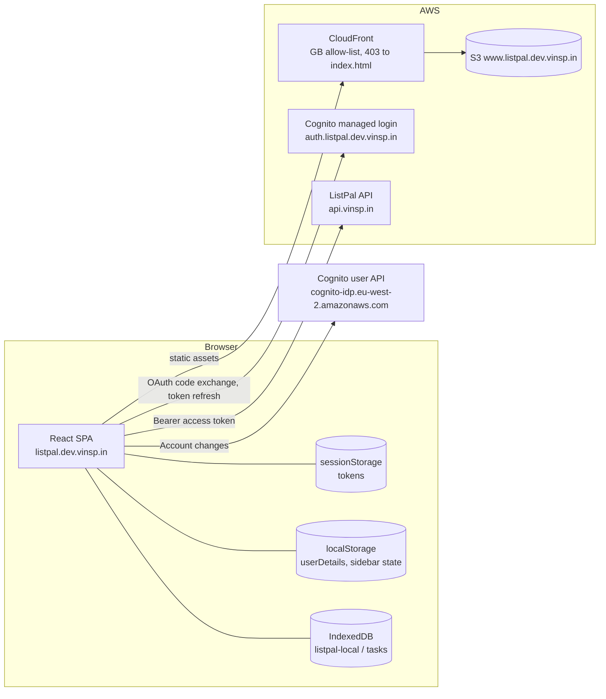

The backend is described in `listpal-backend/ARCHITECTURE.md`. The frontend depends on it for every data read and write.

## 4. Pages and components

### 4.1 Routes

Routes are declared in `App.jsx`. The board route is a `/board/*` wildcard, and `getBoardIdFromUrl` in `utils.js` takes the board ID from the last URL segment. Every route except `/redirect` and `/logout` checks `isAuthenticated()` (which only tests that an access token is present in `sessionStorage`) and redirects to `/logout` when it is missing.

| Path | Component | Purpose | Backend calls |
| --- | --- | --- | --- |
| `/` | none | Redirects to `/home` | none |
| `/home` | `HomePage` | Greeting (from the ID token's `given_name`), coloured pills for the date, week number and days left in the year, one card totalling each period's score across all boards beside them, the board cards, and board creation from a New board card that follows the last board in the grid, which goes straight to the new board. Each card shows the board's name and emoji, its yearly score as a large figure followed by "/ year" at the top right, and its weekly score against its weekly target with a meter capped at full. A total or yearly score of 10,000 or more is abbreviated, such as 12.3K, to fit its space. A long name ends in an ellipsis, with the full name on hover. The page is left-aligned on desktop. At 650 px or narrower, the greeting, pills, headings and score boxes are centred, while a card's contents stay laid out against its edges | none. A new board goes through the outbox to `POST /sync` |
| `/board/*` | `Board` | Tasks grouped by category, scores, targets, board emoji and name, delete, clear completed (an alert says so if there are none). A board with no categories shows a centred panel with a small illustration, a short explanation and a New category button, in place of the add category button. The panel fades in without rising, and the first card and the add category button that replace it appear at once in their final positions. Category cards and the add category button sit in one, two or three equal columns, chosen by the width available, and a row that isn't full leaves its space empty rather than stretching. The delete, clear and target icons each show a hover label. A deleted category card fades out, and the remaining cards slide into place when categories are added, removed or reordered. A new category takes an emoji suggested from its name (an emoji typed in the name, or a word such as "Dentist" or "Groceries"), or ✅ when nothing fits; see "Category emoji" in section 7. The card's emoji picker overrides it, and renaming a category keeps its emoji. A new or renamed category's name is trimmed, so " Car" can't sit beside "Car". Within a card, ticked tasks come first, in the order they were ticked, then unticked tasks in `CreatedDate` order. Tasks edit like lines in a notes app. Enter splits a task at the caret: the text after it (less any selection) moves into a new task directly below, with the caret at its start. Enter at the very start of a task instead adds an empty task above, so the task keeps its link and importance. A new task goes between its neighbours by taking a `CreatedDate` halfway between theirs (fractional if need be), as the server ignores `CreatedDate` on update and neighbours can't be renumbered; above the first unticked task it takes 1 ms before it. The "new task..." button, and Enter at the end of the last unticked task, add at the bottom. Backspace at the start of a task joins it onto the end of the unticked task above, and Delete at the end pulls the task below up into it, with the caret at the join. The upper task keeps its importance and link, a link on the lower one moves up if the upper has none, and a join between two tasks that both have links is refused. Backspace in an empty task deletes it and moves the caret to the end of the unticked task above, or to the start of the one below if it was the first; Delete in an empty task does the same, preferring the task below. Duplicate in a task's menu adds an unticked copy directly below, with the same text, link and importance, and the caret at the end of its text. A ticked task's copy goes first among the unticked tasks, the nearest place below it. Reword in a task's menu asks the backend for a clearer wording and swaps it in, with buttons to keep it or revert to the user's own text; see "Reword" in section 7. Delete in a task's menu deletes it at once, with no confirmation. Deleting a category's only task, by key or from its menu, asks whether to delete the whole category instead, and confirming fades the card out as the category menu's delete does. The last unticked task beside ticked ones can't be deleted: one with text is blanked, and an empty one shows an alert. Shift+Enter is left to the textarea, so it adds a line break within the task. Cmd+Enter ticks the task and moves the caret to the start of the unticked task below, or the end of the one above if it was the last; ticking a card's last unticked task adds an empty one, which takes focus. Confetti for a target met by a tick, by click or Cmd+Enter, bursts from the ticked task's checkbox where the task ends up, so it stays in view when the page scrolls to follow the task. Any other burst, such as one from lowering a target, starts at the mouse pointer. Each target pins its own burst to where it started, so a second target hit while the first burst plays gets its own origin, not the first one's. Enter in a category title moves the caret to the start of the card's first unticked task, and Escape in a title or task leaves it; both save a title rename through blur. These keys do nothing to the list while an input method is composing. Tasks slide into place (300 ms) when one is ticked or unticked, so a newly ticked task visibly moves up to the bottom of the ticked tasks. Adding or deleting a task has no slide: the task appears or vanishes at once and the tasks below jump into place, as sliding them would draw them over the new task or leave a gap where the old one was. A task arriving in a fresh copy from another device is different: it fades in and the tasks and cards below slide to make way | `GET /active-tasks`, `POST /delete-board`, `POST /board-scores` (via `ScoreCounter`), `POST /reword-task` (via `Card`). Name, emoji, targets and category order go through the outbox to `POST /sync` |
| `/settings` | `Settings` | Name, email, password and account deletion in one card, and a grid of theme cards. Each theme card is a button that previews its theme with sample pills and a meter, has a neutral border so it stands out from any page theme, and the chosen one shows a bookmark. Below them, three reword tone cards in the theme cards' style and grid, each showing one sample task reworded in that tone. See "Reword tone" in section 7 | Cognito user API, `POST /delete-account` (via `AccountSettings`), `POST /user-theme` (via `ThemeCard`), `POST /user-reword-tone` (via `RewordToneSetter`) |
| `/redirect` | `RedirectPage` | Receives the Cognito `code`, exchanges it for tokens, then goes to `/home`, where `HomePage` shows its placeholders. The page looks empty unless the exchange takes over a second, when "Signing you in…" fades in. If the exchange fails, it explains why and offers "Sign in again" | Cognito token endpoint |
| `/logout` | `Logout` | Clears storage and sends the user to the managed login | none |
| `*` | none | `/home` when signed in, `/logout` when not | none |

### 4.2 Component tree

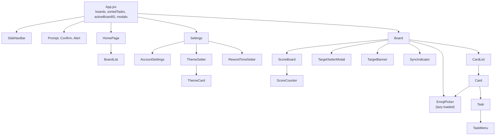

`Board` and `CardList` receive `sortedTasks`, `setSortedTasks`, `setBoards` and the modal setters as props. `setSortedTasks` is App's `setOrderedSortedTasks`: it keeps one identity across renders, takes a value or an updater function, and orders the categories by the active board's `CategoryOrder` unless the caller passes an order. `App` holds the active board as an ID, which `Board`, `SideNavBar` and `BoardList` set, and derives the board object from `boards` for the side bar's highlight and its collapsed "Boards" link. `Board` shows its name, emoji, page title and delete confirmation straight from its entry in `boards`, without copying them into state, so a rename or emoji change shows through `setBoards` alone. Every change to `sortedTasks` builds a new object, a new array for each category it touches and a new object for each task it changes. Nothing is changed in place, because `Card`'s ordered list and memoised children compare by reference and would miss an in-place change. Components that write tasks import the queue functions from `syncEngine.js` directly. Nothing uses React context.

`Task` is wrapped in `memo`, and each Task receives only its own `task` object plus props that keep one identity, so an edit re-renders the edited Task and no other. Every Task renders a textarea, so this matters on a large board. `Card` owns the task-level callbacks and passes them down:

- `setTaskFields(SK, fields)` merges fields into one task in local state. The caller queues the sync.
- `addTask(besideSK, { above, description, caret, link, important })` creates a task directly below `besideSK` (or above it, with `above`) when given, or at the bottom (the "new task..." button). A split passes the text after the caret as `description`. A duplicate also passes the link, the importance and a caret at the end of the text.
- `joinTask(SK, withAbove)` joins a task with the unticked task above or below it, and returns whether it did.

A new task, or one whose text a join changed, needs the caret placed after React has written its text, as React moves the caret to the end whenever it changes a textarea's value. `Card` leaves a request in `focusRequestRef` (`{ SK, caret, description }`), and the matching `Task` acts on it in a layout effect once it shows that text. `CardList` owns the ref, because a new category's first task asks for the caret from a `Card` that doesn't exist yet. This request is the only way a task takes focus. A task that merely loads never does, even an empty one, because focusing it would scroll the page to it. The new task button, Enter, Duplicate Task, ticking a card's last unticked task and creating a category all ask; an empty task pushed in above the caret by Enter at a task's start doesn't.
- `toggleTaskChecked(SK, isChecked)` ticks or unticks, applies the optimistic score change, and adds an empty task when the last unticked one is ticked.
- `rewordTask(text)` calls `POST /reword-task` with the card's title and the board's name as context, and returns the new text. The board name comes from a ref, so renaming the board doesn't give every Task a new callback.
- `deleteTask(SK, title)` wraps `CardList.handleDeleteTask`. For the category's only task it blurs the task, so keys typed behind the modal can't reach it, and asks to delete the category instead.

They write through `setSortedTasks` updaters, so they always start from the latest state. Where a decision drives a side effect (whether to create the empty task, which score periods to reduce), `Card` reads its latest tasks from a ref. `CardList.handleDeleteTask` works the same way, reading `sortedTasks` from a ref to keep the last unticked task beside ticked ones. `CardList.handleNewCard` reads the same ref and writes through an updater, as the new category prompt holds the function from when it opened: a fresh copy of the board landing meanwhile would otherwise be overwritten, and the name check and category order would use the old categories. `Card` itself still re-renders on every edit, because `sortedTasks` is one object. The category-level handlers (rename, emoji, delete, move) are not passed to Tasks, so they read `sortedTasks` from props.

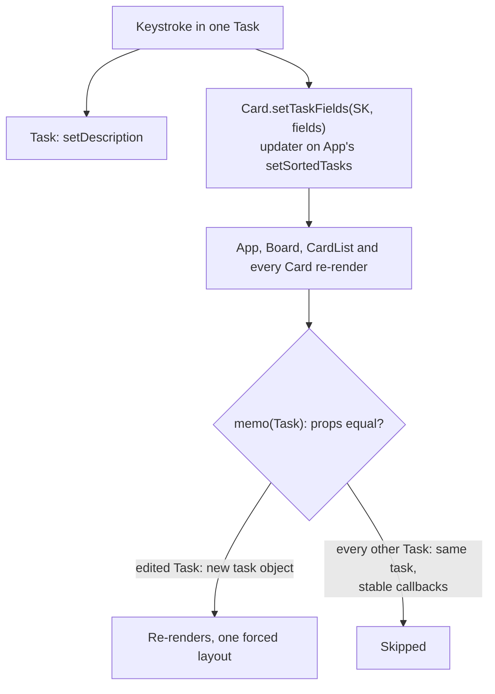

## 5. Authentication and session

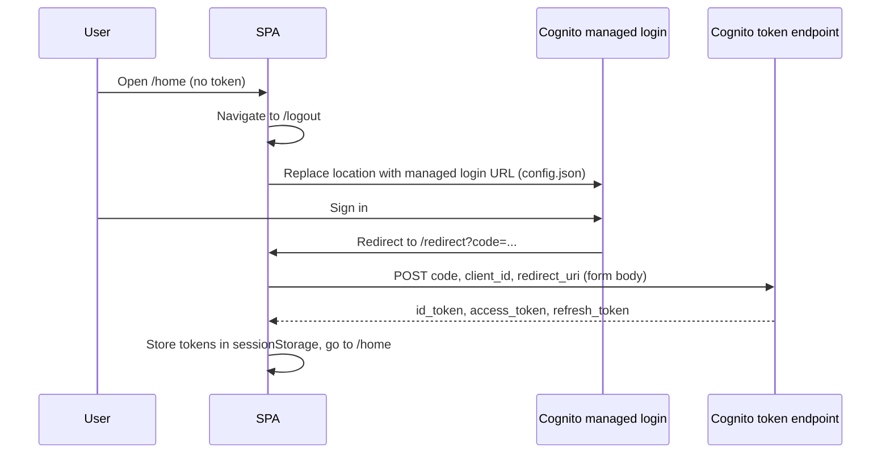

Points to know:

- The redirect URI is chosen by `isDev`, which App.jsx derives from `process.env.NODE_ENV`. Local dev returns to `http://localhost:5173/redirect`. Production returns to `https://listpal.dev.vinsp.in/redirect`. Both must be registered as Cognito callback URLs.
- A failed code exchange shows the reason from `describeApiError` on `RedirectPage`, in place rather than as a dismissible `Alert`, as there is no page behind it to go back to. Its "Sign in again" button goes to `/logout`, because a code works only once and a retry needs a fresh one.
- Before every API call, `apiGatewayClient.js` checks the access token's `exp` claim. If it has passed, `authService.refreshTokens` POSTs `grant_type=refresh_token` to the token endpoint, as a form body like the code exchange. Calls that find the token expired at the same moment share one refresh. The response has no refresh token (rotation is off), so the stored one is kept. There is no AWS SDK in the bundle and no AWS credentials involved.
- If the refresh fails, `sessionStorage` is cleared. The next render sees no token and routes to `/logout`.
- Logout clears both `localStorage` and `sessionStorage` and then replaces the location with the managed login URL.
- The `Authorization` header is `Bearer <accessToken>`. The ID token is only read locally, for the greeting and the Account section.
- Sign-up also happens on the managed login, and Cognito tells ListPal nothing about it. A new user has no records until `loadAccount` finds `GET /user` empty on their first load and calls `POST /new-user`, which creates the user and an example board called "Welcome" with its tasks. It then reads the user and boards again. If setup fails, the API error alert shows, the theme stays as it was, and the next load tries again.
- Sign-in requests the `openid` and `aws.cognito.signin.user.admin` scopes. The second lets the access token call Cognito's user API. A session from before it was added gets `NotAuthorizedException` on account changes and is told to sign out and back in.

### Account changes

`AccountSettings` shows Name, Email and Password as rows that open a form in place, one at a time, and Delete account below them. `accountService.js` calls `cognito-idp.<region>.amazonaws.com` directly with axios, using the `X-Amz-Target` header and the access token, so no AWS SDK or backend route is involved. The one exception is deletion, which needs the backend to remove DynamoDB data.

- **These changes need the network.** They don't use the outbox. A failure shows under the form and keeps what the user typed.
- **Passwords stay out of logs.** Axios errors carry the request body, so `callCognito` throws a new error holding only Cognito's error name and message, and callers log only the name.
- **Name.** Filled fields go through `UpdateUserAttributes` and blank ones through `DeleteUserAttributes`. The tokens are then refreshed, as the ID token is the only place the app reads them from.
- **Email.** The user pool keeps the current email active until the new one is verified. Cognito can't report a pending email, so `requestEmailChange` keeps it in `sessionStorage` and the code form comes back after a reload. Resending calls `UpdateUserAttributes` again.
- **Password.** Changing it needs the current password, and "Forgot your password?" swaps that field for an emailed code. Either way, `GlobalSignOut` then revokes all refresh tokens and the user is sent to sign in. Access tokens keep working on the API until they expire, because the JWT authoriser doesn't check revocation.
- **Sign-out goes through Cognito's `/logout`.** `endSession` uses `managedLogoutLocal` or `managedLogoutRemote` from `config.json`, so Cognito's own login session ends too. The ordinary Log Out button still goes straight to the login page.

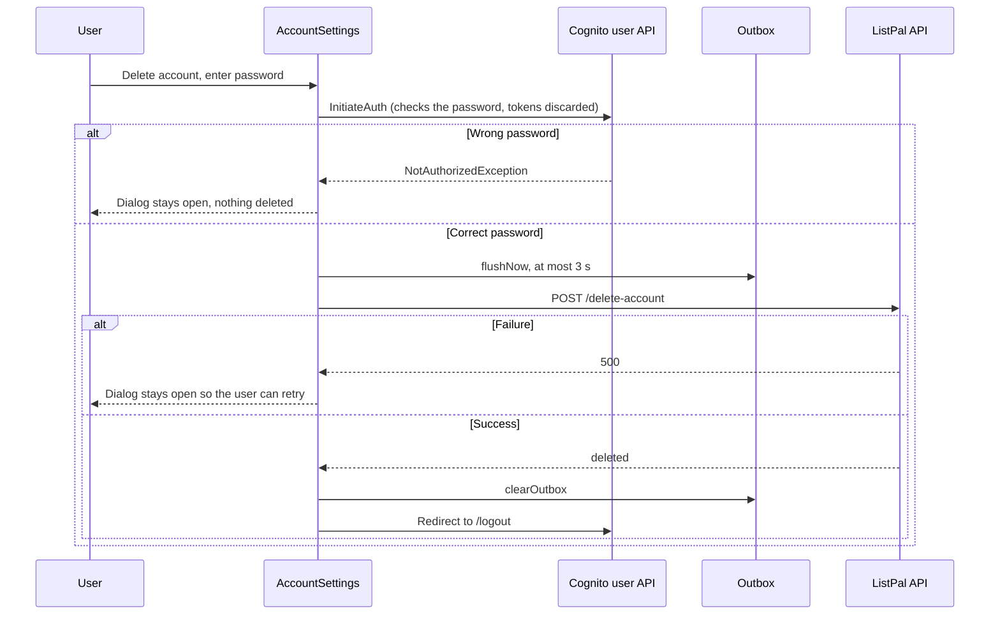

The password check runs in the browser, so it guards against someone at an unlocked device, not against a stolen token. `clearOutbox` matters because the outbox survives logout and would otherwise resend the deleted user's edits at the next sign-in on that browser.

## 6. Data and state

The frontend owns no durable data. Everything persistent lives in the backend. The browser holds five kinds of state.

| Store | Key or shape | Written by | Lifetime |
| --- | --- | --- | --- |
| React state in `App.jsx` | `boards`, `sortedTasks` (tasks grouped by category), `userDetails`, `activeBoardID` (the board object is derived from `boards`), modal config | Pages through props | Until a reload |
| Module state in `boardCache.js` | The last `sortedTasks` shown for each board, keyed on board ID | `Board.jsx` whenever the shown board's `sortedTasks` changes, except the empty board shown behind a load error; dropped when the board is deleted | Until a reload or logout (which reloads). Survives Board unmounting |
| IndexedDB `listpal-local` / `outbox` | One record per task or board with queued changes: `{ SK, boardID, kind, fields, rev }`, keyed on `SK`. A board record has `SK` and `boardID` both set to the board ID, `kind: "create"` (a new board) or `"update"`, and only board settings in `fields` | `queueCreate`, `queueUpdate`, `queueDelete`, `queueUpdateAll`, `queueDeleteAll`, `queueBoardCreate`, `queueBoardUpdate` in `syncEngine.js`. `forgetBoard` drops a deleted board's records, `clearOutbox` drops everything once the account is deleted | Until the server confirms the change. Survives reloads and logout |
| `sessionStorage` | `idToken`, `accessToken`, `refreshToken` | `authService.js` | Browser session |
| `sessionStorage` | `pendingEmail`, the new address awaiting its code | `accountService.js` | Until the change is confirmed or cancelled, or logout |
| `localStorage` | `userDetails` (user record: theme and reword tone) | `App.jsx` after loading, `ThemeCard` and `RewordToneSetter` on change, all through `userDetails.js` | Until logout |
| `localStorage` | `sidebarIsOpen`, `sidebarBoardsMenuIsOpen` (`"true"` or `"false"`), read once as the initial React state | `App.jsx` whenever either value changes | Until logout |
| `localStorage` | `boardCount`, the number of placeholder rows to show during the next load, read once as the initial React state | `App.jsx` whenever the number of boards changes, unless it is zero, as a failed load also leaves no boards | Until logout |

`App.jsx` loads the user and the boards on start-up. `getBoards()` waits for an outbox flush first (at most `LOAD_FLUSH_TIMEOUT`, 3 s). Otherwise a tick queued just before a reload, or still in flight from the old page's keepalive request, could land after the scores were read. It reads the outbox before the flush and again after `GET /boards`, parses `CategoryOrder` from a JSON string into an array for each board, and lays queued board settings over the result with `applyPendingBoards`, so a rename, emoji, target or category order change that hasn't reached the server yet still shows after a reload. A board whose create is still queued isn't on the server, so `applyPendingBoards` adds it from the outbox with `NEW_BOARD_DEFAULTS` (the server's defaults) and its queued fields. `SideNavBar` renders as soon as the user is signed in, fading in over 250 ms ease-out. Until this first load settles (`initialLoadDone`) its Boards menu shows pulsing placeholder rows instead of boards, and `HomePage` shows its greeting and date pills with placeholders for the scores and board cards. Each has one placeholder per board at the last visit (`boardCount`, or 3 on a first load). Placeholders are the height of what replaces them, so nothing moves when the boards arrive, and the add board button keeps its place while hidden. The pulsing bars wait 250 ms, the length of the page's entrance, then fade in over 200 ms, so a fast load replaces them before they can be seen. A placeholder card's frame shows from the start. When a real card replaces it, the frame stays solid and only the contents fade in, over 300 ms (`placeholderReveal-animation`), because fading the whole card would make the frame vanish and return. Scores, sidebar rows and the add board button use the same 300 ms. Cards beyond the placeholder count, and those shown when returning to Home, still fade whole over 200 ms. Board pages then load their tasks separately, in `getTasks` in `Board.jsx`:

1. It reads the outbox (`readPending`).
2. It calls `getActiveTasks(boardID)` and `flushNow` (waiting at most 3 s) in parallel. If the board's own create is still queued, the server would refuse the fetch, so it flushes first and fetches only if the create has landed. Until then every task on the board is queued too, so the outbox alone holds the board.
3. It reads the outbox again, merges the two reads with `mergePending`, and lays them over the fetched tasks with `applyPending`. A change settled by that flush is still in the first read, so it shows even if the fetch read the server before the flush landed. Queued changes hold whole field values, so applying one the server already has changes nothing.

Each board switch is numbered (`loadCount`), and only the latest load's response is applied.

While a board's tasks load, its header stays on screen, as `boards` already holds its name, emoji and scores. The cards wait until the tasks are ready and then fade up, with nothing in their place meanwhile. The delete, clear and target icons are dimmed and ignore clicks until the tasks land, because `sortedTasks` still holds the previous board's tasks until then, and clearing would delete those. The cards also leave the screen while a board's delete requests run. On a direct page load the board isn't known yet either, so the header waits for the boards and then fades up. The boards page has no placeholders. There is no shared loading flag: `Board` decides from `loadedBoardID`, and each page's loading state can't affect another. A board switch also returns the page to the top, as the header no longer collapses it.

Switching to a board shown before in this session is instant. A layout effect puts the cached copy from `boardCache.js` on screen before the browser paints, so the cards never leave the screen, and `getTasks` then runs in the background: no alert on failure, and the cached copy stays if it fails. When the fresh copy arrives it replaces the cached one, unless the user edited the board in the meantime. `Board` sets `remoteUpdateRef` for the commit that lands it, so `Card` and `CardList` can animate the difference: new tasks fade in and whatever moved slides. Edits always produce a new `sortedTasks` object, so Board compares against the value the cached copy landed as; those edits are queued, so nothing is lost by keeping them. Because a fresh copy can replace tasks in place, `Task` derives its tick from `task.CompletedDate` rather than keeping its own state, and `Card` follows its first task's `Emoji`.

### 6.1 Refresh on return

A page left open on one device goes stale when the user edits the same boards on another. `watchForReturn` in `refreshOnReturn.js`, started once by `App`, calls back when the user is likely to be looking at the page again:

- the tab becomes visible (`visibilitychange`)
- the window regains focus
- the browser comes back `online`
- the computer wakes from sleep: a 15 s interval notices when far more than 15 s has passed between ticks, because a laptop can wake with the tab visible and focused and fire no event
- the first pointer or key input after 5 minutes without any, for a laptop left open on the board, which may never hide the tab or lose focus

Each trigger is ignored while the tab is hidden, and only one refresh runs per 30 s (`STALE_AFTER`), so flicking between tabs doesn't refetch every time. Nothing polls, so a tab nobody is looking at makes no requests. A refresh costs one `GET /boards` and, on a board page, one `GET /active-tasks`.

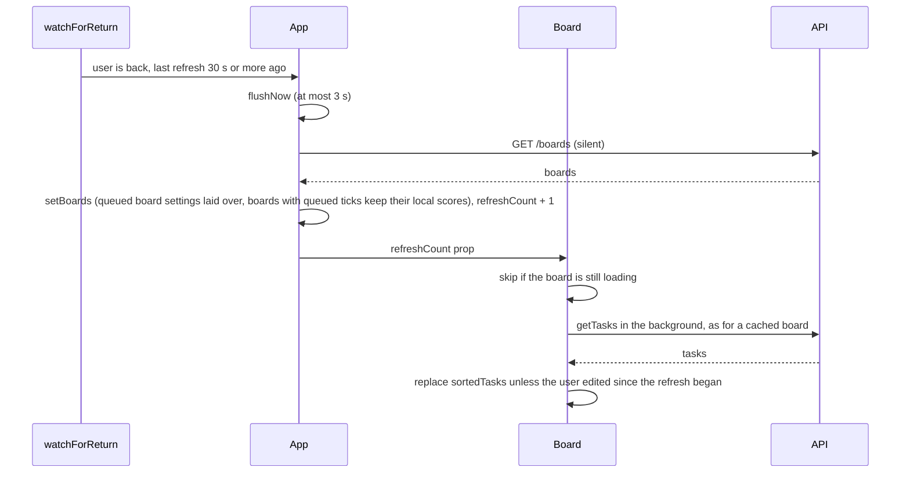

Points to know:

- Boards land before `refreshCount` moves, so the tasks are sorted by the latest `CategoryOrder`.
- The task refetch reuses the background load of a cached board: the board as it stood when the refresh began is the baseline, and an edit made while the request is in flight keeps the local copy. That edit is queued, so nothing is lost, but the remote changes then wait for the next refresh.
- A board with task changes still queued on this device keeps its own `WScore`, `MScore` and `YScore`, because the server's scores don't include them yet. A queued board settings change doesn't count here, as it can't move scores.
- Queued board settings are laid over the fetched boards with `applyPendingBoards`, using the same two outbox reads, so a refresh that lands mid-request can't put an old name or category order back on screen.
- A target met on another device shows its star but no confetti or banner, the same as loading a board that is already over target. `ScoreCounter` treats a score change that arrives with a new `refreshCount` as a load rather than a crossing. It updates its copy of `refreshCount` in a separate effect, so a refresh that changes nothing doesn't bulge the counters. Counters bulge only when a score or percentage changes on the board they're showing, not when a board opens.
- Failures are logged and ignored: what is on screen stays, and the next trigger after 30 s tries again.
- The user's theme and name are not refetched.

## 7. Task writes and sync

Task edits and board settings (name, emoji, targets, category order) do not call the API directly. Components call the queue functions in `src/utils/syncEngine.js` with only the fields that changed. The engine stores them in the IndexedDB outbox and sends them in batches to `POST /sync`. The engine is a module singleton, not React state. `App.jsx` calls `startSync` once.

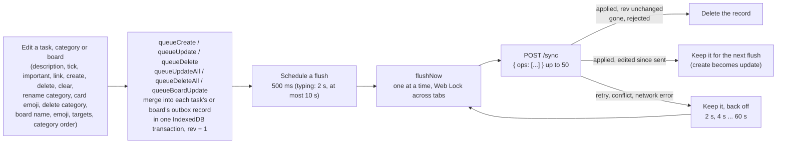

How the outbox works:

- **One record per task.** `mergeRecord` combines changes:
  - create + update stays a create
  - update + update merges the fields
  - anything + delete becomes a delete
  - a delete ignores later edits, so the task cannot come back
- **Category actions are per-task changes.** Renaming a category, changing a card's emoji, deleting a category and clearing completed tasks queue one change per task with `queueUpdateAll` or `queueDeleteAll`, in a single transaction. They merge with any queued edits like any other change, so a pending edit can't undo a rename. They work offline too. A large category is sent over several batches of 50.
- **Board settings are one record per board.** `queueBoardUpdate` writes to a record keyed on the board ID, so two quick category moves or emoji picks merge into one op carrying the latest value, and nothing can arrive out of order. `CategoryOrder` is queued as the JSON string the server stores. Each caller updates `boards` first with a functional updater, so the change shows at once and works offline. The server applies board ops before task ops in a batch, and reports `gone` for a board deleted since.
- **New boards are queued too.** `BoardList` adds the board to `boards`, calls `queueBoardCreate`, a `create` record holding `Board`, and goes straight to the new board. It caches an empty task list for the board first, so the page shows at once rather than waiting for the create to sync, and working offline or a slow sync can't hold it up. Later settings merge into it like task edits into a task create. Board records are keyed `b#...`, which sorts before `t#...`, so `getAll()` returns them first and a batch cut at 50 always sends a board ahead of its tasks. The server creates the board first and accepts that batch's tasks for it. If the create hits a transient error, those tasks come back `retry` with it, rather than `unknown board`.
- **Deleting a board clears its records.** `Board` flushes, calls `POST /delete-board`, then `forgetBoard` drops whatever is still queued for the board and its tasks. A queued create whose ack was lost would otherwise recreate the board. It runs between syncs (the same lock as `flushNow`), so a record can't be dropped while it is mid-request. A board is always deleted on the server, even one whose create may not have arrived: opening a board flushes the outbox, and a create counts as possibly on the server once a send has been tried, so by the time the delete button can be pressed the board can't be known to exist only here.
- **Create then delete.** A create that was never sent and is then deleted is dropped without a request. If the create may already have been sent (`maybeOnServer`), it becomes a delete instead.
- **Acks are matched by `rev`.** A record edited while its request was in flight is kept, so nothing typed during a sync is lost.
- **When flushes happen:** after the scheduled delay, when the browser comes back `online`, when the tab is hidden, and at start-up if anything is queued. On `pagehide`, `syncOpsKeepalive` sends the in-memory copy of the queue with `fetch(..., { keepalive: true })`. The records stay queued either way. The server treats a resend as a no-op.
- **Scores come from the server.** Ticking applies an optimistic change to `boards`, using `periodsContaining` from `utils.js` (the same UTC reset boundaries as the backend). The server changes the scores in the same transaction as the tick and returns them. `onBoardScores` writes those values into `boards`, but only once nothing else is queued for that board, so a stale value can't briefly reach the screen and re-trigger confetti.
- **Status indicator.** `useSyncStatus` exposes `{ pending, syncing, lastError }`. Only `SyncIndicator.jsx` subscribes to it, so a status change re-renders the indicator and nothing else. Its bottom-right indicator, rendered by `Board`, is a small muted icon in the theme's colours, a tick when all is saved, and spins while changes are pending. While retrying, it gets a red ring and a red pill to its left ("Offline, will sync later" or "Save hiccup, retrying..."). The tooltip explains the same in a little more detail; it never shows the raw error. When queued edits reach the server after a spell offline, a green "Back online, all caught up" pill shows for 3 s. The pills don't wrap and sit fixed at the bottom right, so keep their text short enough to fit a phone screen. The indicator and pills sit at `z-index: 2500`, above the bottom gradient and side bar (2000) but under the modal backdrop (3000), so an open prompt, confirm, alert or targets modal blurs them like the rest of the page. `beforeunload` warns only while changes are pending and syncing is failing (`lastError` set). `App.jsx` registers that listener once and reads the status with `getSyncStatus()` when the page unloads, rather than subscribing. A healthy queue needs no warning, because reloads resend it. The browser can't tell a reload from a close, so a reload while offline still shows the prompt.

Edits that bypass the queue and call the API straight away. Deleting a board and editing a score first call `flushNow` (waiting at most `LOAD_FLUSH_TIMEOUT`, 3 s). A board's delete reads its tasks and then removes them, so a sync creating a task in between would leave that task behind with no board. A score edit sets the value outright and already counts any tick still queued, so a tick landing after it would count twice. If syncing is failing, they go ahead after the 3 s:

| Action | Where | Endpoint |
| --- | --- | --- |
| Manually edit a score (the input takes whole numbers only and drops leading zeros, so an edit with any other character is ignored; raising a weekly score also lifts the monthly and yearly scores to at least that value, and a monthly score lifts the yearly one; lowering a score changes nothing else) | `ScoreCounter.jsx`, `parseScoreInput` and `applyManualScore` in `utils.js` | `POST /board-scores` |
| Delete a board | `Board.jsx` | `POST /delete-board` |
| Save theme | `ThemeCard.jsx` | `POST /user-theme` |
| Save reword tone | `RewordToneSetter.jsx` | `POST /user-reword-tone` |

### Reword

Reword in a task's menu asks the backend for a clearer, action-first wording of the task and puts it in place of the old text. The call is direct, but the new text is saved like a typed edit: `saveDescription` sets it on screen and queues a `Description` update in the outbox, so it syncs through `POST /sync`, survives a reload and works if the network drops straight after. The route takes text and returns text; it writes nothing itself. The backend side (quotas, moderation, OpenAI) is in `listpal-backend/ARCHITECTURE.md`, "Task reword".

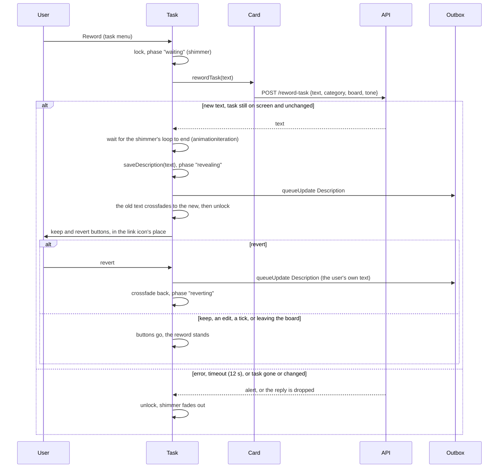

- **Offered** first in the task menu, only on an unticked task whose trimmed text is 1 to 500 characters (`TASK_MAX_LENGTH`, the server's limit). The menu hides the item otherwise. The task textarea itself stops at the same 500 characters (`maxLength`, so pastes are cut), and a join that would pass it is refused.
- **The lock.** While a reword runs, from the request to the end of the crossfade, and during a revert's crossfade, the textarea is `readOnly`, and Enter, Backspace and Delete are ignored in it, as `readOnly` doesn't stop the app's own split, join and tick handlers. The checkbox and the menu button ignore clicks. Arrow keys and Escape still work. The row gets `aria-busy` and a class for its phase. The lock always ends: `rewordTask` has a 12 s timeout, above the reword Lambda's 10 s.
- **The animation.** `rewordPhase` goes `waiting`, then `revealing` when there is new text, then `settling` if the new text is a line or more shorter and the row has to close up, or `fading` instead when there isn't new text, then back to `null`. A revert goes `reverting`, then `settling` if need be. `fading` doesn't lock the task. While waiting, a 150 px band of the accent colour runs through the letters at 250 px a second, whatever the task's length. `Task` measures the text (its widest wrapped line, as the band crosses every line at once) and sets how far the band travels and for how long as CSS variables, which the keyframes read. On a short task the band carries on out of sight to at least 320 px, so the loop doesn't flicker. A textarea can't colour its own letters, so the shimmer is a copy of the text (`.task-shimmer-mirror`, wrapped like the highlight copy) laid exactly over them at `z-index: 1`, with a gradient clipped to its glyphs (`background-clip: text`). Inside the band the letters take the accent colour, and elsewhere the copy is clear and the real text shows. Clicks pass through it. The background is cloned across wrapped lines (`box-decoration-break: clone`), so each line paints its own gradient from its left edge and the band crosses all the lines together as one wall. The copy exists while waiting and fading.
- **The crossfade.** A reply waits in `pendingRewordRef` until the shimmer's loop ends (`animationiteration`), when the band is just past the text, so the band is never cut off midway. The text is checked again then, in case an edit from another device landed meanwhile. The new text is saved and the old text fades to the new over 350 ms: the real text turns transparent, and two copies (`.task-fade-old`, `.task-fade-new`) sit over it, one fading out as the other fades in. A flash of the new text's letters in the accent colour marks the switch. It waits 400 ms, so the crossfade is seen first, then rises quickly and fades out over 750 ms. It is a third copy of the new text (`.task-flash-mirror`, `z-index: 2`) laid over the other two, so it colours the same glyphs. A second sizer holds the old text, so the row keeps the taller of the two heights until the flash ends, and grows to the new height at the start if that is taller. The flash's `animationend` ends `revealing`; a row that was taller then closes up in `settling`. Under reduced motion there is no loop to wait for, so the new text goes straight in, with no crossfade.
- **Timing.** The phases end on animation events rather than timers, so the CSS alone sets the timing. The shimmer fades in over 200 ms. When nothing is swapped in (an error or a dropped reply), it fades out over 200 ms while still sweeping, and that fade's `animationend` ends `fading`. A tab in the background can hold the animations, and the lock with them, until it is shown again.
- **Keep or revert.** Forced new wording can change a task's meaning ("Renew passport" became "Update passport details"), so once the reword has landed, two buttons take the link icon's place: keep (a tick) and revert (an undo arrow). They are packed tighter than the row's other icons, so the menu button showing on hover doesn't narrow the text and rewrap it. A link comes back once the user decides. The reword has already been saved, so keep only clears the buttons, and revert saves the user's own text as another ordinary `Description` update through the outbox. The revert crossfades back like the reveal, through the `reverting` phase, but without the accent flash, which marks new wording, not the user's own. The fade-in copy's own `animationend` ends that phase. Under reduced motion the text swaps at once. `rewordChoice` in `Task` holds the user's text and the reworded text, in memory only. There is no timer, but an effect ends the choice, with the reword kept, as soon as the text no longer matches the reword or the task is ticked. That covers typing, a split or join, and a fresh copy from another device without each needing to know about it. Clicking into the task doesn't end it. Leaving the board unmounts the `Task`, which ends it too; a tick or re-sort doesn't, as `Task` is keyed by `SK`. Reword stays in the menu while the choice is open, and `nextRewordChoice` in `utils.js` keeps the user's own text as the revert target through a second reword. If a reword gives back the user's own text, there is nothing left to revert, so no buttons show. Pressing a button from the keyboard (a click with `detail` 0) moves focus into the task, as the button disappears; a mouse click leaves focus alone. A visually hidden `role="status"` region in each task announces the new wording when the buttons appear. A revert doesn't give back the day's reword.
- **When the reply is dropped.** `rewordToApply` in `utils.js` applies the reply only if it is non-empty, different from the text sent, and the task's text is still what was sent. A join into the task from the one below, or a fresh copy from another device, changes it. The reply is also dropped if the `Task` has unmounted, for example after a board switch, as `setTaskFields` would otherwise write into the next board's tasks. Focus doesn't move.
- **Context.** `Card` sends its title and the board's name, each cut to the server's 100 characters. `Board` passes the name down through `CardList`.
- **Reword tone.** The user picks casual (the default), concise or formal in Settings, saved as `RewordTone` on the user record. `RewordToneSetter` updates `userDetails` and `localStorage` at once and calls `POST /user-reword-tone`, as theme cards do. `Card` reads the tone from `localStorage` with `storedRewordTone` when a reword starts, rather than taking `userDetails` through `Board` and `CardList`. A missing tone, or storage that can't be read, sends casual, and the server falls back to casual for anything it doesn't know. Each card's sample is hand-written in `rewordTones.js` to follow that tone's rules on the server, so Settings never spends reword quota. The tones' rules, and why a playful tone was tried and dropped, are in `listpal-backend/ARCHITECTURE.md`, "Task reword".
- **Errors** go through `apiPost`'s usual alert. `describeApiError` checks the body's error code before the status, so the reword route's codes get their own text (`CODED_ERRORS` in `apiErrors.js`): `daily_limit` (429, 30 a day), `busy_today` (429, everyone's 500 a day used), `flagged` (400, refused by moderation) and `reword_unavailable` (502). Each says the task is unchanged. A gateway 429 with no code keeps the generic "Too many requests" text, and a timeout reads as a connection problem.

### Category emoji

A new category's first task takes an emoji suggested from the category's name, in place of the fixed ✅ it used to get. Like every card emoji it is stored on each task (`Emoji`), and `Card` shows the first task's. `suggestEmoji` in `src/utils/categoryEmoji.js` is synchronous, offline and makes no AI call: the new category prompt closes as soon as `handleNewCard` returns, so there is nothing to wait for. The suggestion is made once, at creation. Renaming a category leaves its emoji alone, and the card's emoji picker is the override.

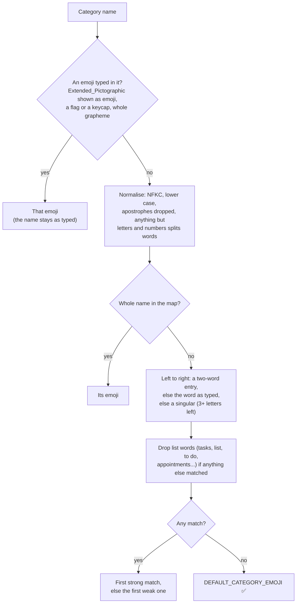

- **The map.** `CURATED_EMOJI` groups about 470 keys under some 135 emoji, covering everyday to-do categories and British words (flat, uni, bins, MOT, council tax, GP, mum, nursery). It includes plurals and -ing forms that are the usual name for a category, as the singular rule is only tried afterwards and only when three or more letters remain, so "christmas", "bus" and "news" aren't cut down. Home 🏠, Work 💼, Health 🏃, Getting started 💡 and Someday 🌱 agree with the Welcome board (`listpal-backend/src/welcome_board.js`).
- **Tiers.** A strong entry names a concrete subject (dentist, car, dog, groceries, gifts). A weak one only says roughly where a task lives (home, work, personal, admin, misc, life, daily, kids, mum, rooms such as kitchen), so "Work admin" gives 💼 but "Mum's birthday" gives 🎂 and "Kitchen reno" 🛠️. A two-word entry such as "car insurance" or "birthday gifts" is taken before its words, so it can outrank a strong word inside it. List words (`CATEGORY_STOPWORDS`) are dropped when another word matched, so "Dentist appointments" gives 🦷 but "Appointments" alone still gives 📅.
- **Which emoji.** Each value is the exact `native` string of an `@emoji-mart/data` entry, VS16 (U+FE0F) included, so ✈️ and 🗑️ never show as text glyphs, and no newer than Emoji 12, as the emoji syncs to every device and an older one draws a newer emoji as two glyphs. There are no skin-tone or gendered people emoji. The tests check every value against the real data. The module doesn't import the data itself, so the picker's chunk stays lazy.
- **Typed emoji.** Detection uses `\p{Extended_Pictographic}`, not `\p{Emoji}`, which also matches digits, `#` and `*` ("Order 1" stays on the default). A pictograph with neither emoji presentation nor VS16 shows as a text symbol (©, ™), so it doesn't count. `Intl.Segmenter` takes the whole grapheme, so ZWJ sequences, VS16, flags and keycaps survive. A browser without it falls back to code points, which keeps only the first part of a ZWJ sequence.
- **Names in other scripts.** Normalising keeps any script's letters and marks (`\p{L}`, `\p{M}`, `\p{N}`), so "Einkäufe" or "買い物" aren't mangled. The map is English only, so they get ✅.
- **No search fallback.** A whole-word search over `@emoji-mart/data` for names the map misses was left out on purpose. Its `SearchIndex` matches prefixes ("pet" finds a petri dish, "tax" a taxi), and even a whole-word index over its keywords picked a fitting emoji only fairly often, while loading the data on the new category path would cost the picker's chunk. Add one only if measurements show too many real names left on the default.

## 8. API client

`src/utils/apiGatewayClient.js` is the only place that builds URLs. Each exported function maps to one backend route.

| Function | Method and path | Backend status |
| --- | --- | --- |
| `getBoards` | `GET /boards` (silent for a refresh on return) | Present |
| `getUser` | `GET /user` | Present |
| `setUpAccount` | `POST /new-user`, on a new user's first load | Present |
| `getActiveTasks` | `GET /active-tasks` (silent for a background refresh of a cached board) | Present |
| `syncOps` | `POST /sync` (silent, the sync engine reports failures) | Present |
| `syncOpsKeepalive` | `POST /sync` with `fetch` keepalive, used on `pagehide` | Present |
| `updateThemeAPI` | `POST /user-theme` | Present |
| `updateRewordToneAPI` | `POST /user-reword-tone` | Present |
| `deleteBoard` | `POST /delete-board` | Present |
| `updateBoardScoresAPI` | `POST /board-scores` | Present |
| `rewordTask` | `POST /reword-task` (12 s timeout) with the user's tone, returns the new text | Present |

Failures are handled the same way for every call. `apiGet` and `apiPost`, both thin wrappers over one `request` function, log the error, show the in-app `Alert` modal (unless the call passes `silent`) and rethrow. The app never uses `window.alert`, which would block the page. A failed token refresh throws an error with code `SESSION_EXPIRED` rather than returning an empty value. The backend returns real HTTP status codes (400, 403, 500) for errors, so axios rejects on them.

Each exported function passes an `action` such as "load your boards" or "save the score". `apiErrorAlert` in `apiErrors.js` combines it with the kind of failure, so the user reads "The internet seems to have wandered off, so we couldn't save the score" rather than "Request failed with status code 500". Each kind of failure gets its own light-hearted title (such as "Oops, that's on us 🛠️" for a 5xx), but the text always says what failed and what to do next. An expired session (or a 401) adds a "Sign in" button that goes to `/logout`, which clears the old tokens and opens the sign-in page. Queued task edits sit in IndexedDB, which logout leaves alone, so they are sent after signing in. Errors that are not from axios, such as a failed outbox read, get a general message rather than blaming the network.

The client is not a React component, so it reaches the modal through `alertBus.js`. `App` registers its `setAlertConf` as the one listener when it mounts.

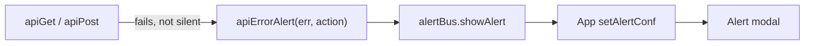

Callers that already handle the failure (delete in `Board`) don't show a second alert of their own. `Board`'s task load passes `silent` and reports the failure itself, because the outbox reads in the same `try` can fail too. The `Alert` sits at `z-index: 3100`, above the targets modal at 3000.

Enter accepts the default option of any open modal, through `useEnterToAccept`: Confirm in `Prompt` and `Confirm`, "Got it" or the action button (such as "Sign in") in `Alert`, Save in `TargetSetterModal` and Delete account in the delete account modal, which still needs its password. Escape or a click outside cancels. Every modal gets all three through `useModalControls`, which wraps `useEnterToAccept`.

- Enter goes only to the top modal, so an API error alert over an open `Confirm` closes without confirming it.
- The listener runs in the capture phase and stops the event, because an alert can open with focus still in a task behind it, and the task would otherwise split. It also means the keystroke that opened a modal can't close it, as when Enter in an empty category title raises "Name, please!".
- A button focused inside the modal, such as a tabbed-to Cancel, handles Enter itself.
- A held key's repeats are swallowed without accepting, and Enter that an input method is using to compose is left alone.

Target banners aren't modals: they don't block the page and close on their own, so Enter stays with the task being edited.

`Prompt`, `Confirm`, `Alert`, `TargetSetterModal` and the delete account dialog share `Prompt.css`. A dark, lightly blurred backdrop fades in and the panel rises into place (`modalRise`, 200 ms). The panel is 420px wide with a 22px title, and has a soft shadow and no outline. Fields inside it use the darker `--background`, and show focus only through the caret. The default button is solid `--accent` and the other is a neutral tint. Buttons have no focus ring: one reached by keyboard changes shade instead. Under 650px it fills the screen less a 16px gutter each side, the title drops to 20px, and the buttons share the row equally. The Settings page's account card uses the same buttons and fields at a smaller size, set in `AccountSettings.css`. Titles use `text-wrap: balance`, so one that must wrap splits into even lines rather than leaving its emoji alone on the second. Keep fixed titles short enough for one line on desktop (about 25 characters with an emoji).

## 9. Styling and theming

- Each component imports its own CSS file. There is no CSS-in-JS.
- `App.css` defines twelve themes, each as a `[data-theme="<id>"]` block. Four are original: `purple-haze` (the default), `granite`, `aqua-mentos` and `cherry-violet`. Eight follow editor colour schemes: `dracula`, `nord`, `gruvbox`, `tokyo-night`, `solarized`, `one-dark`, `monokai` and `rose-pine`. Each sets `--background`, `--foreground`, `--text-colour`, `--accent` and `--accent-2`. The `purple-haze` block also applies to `:root`, so a missing or unknown theme name falls back to it.
- `src/utils/themes.js` lists each theme's ID and display name. `ThemeSetter` builds the Settings cards from it.
- Text in `--text-colour` sits on `--accent` (buttons, date pills, tooltips), so an accent must be dark enough to read on. The original themes range from about 2.4:1 to 3.3:1, and new themes should stay within that. Pastel schemes therefore use their deepest shade as the accent: Dracula uses its red, not its pink or purple.
- Ticking a box fills it over 140 ms while the tick, a mask uncovered from the left, is drawn over 200 ms. These are transitions rather than keyframes, which would replay on every ticked box each time a board loads.
- Ticking a box fills it over 140 ms while the tick, a mask uncovered from the left, is drawn over 200 ms. These are transitions rather than keyframes, which would replay on every ticked box each time a board loads.
- Reword's shimmer and crossfade are in `Task.css` (`rewordShimmer`, `rewordFlash`, `rewordGrow`, `rewordSettle`, plus the shared `fadeInPure` and `fadeOutPure`, which also fade in the keep and revert buttons). `Task` ends the `fading` phase on the shimmer's `fadeOutPure`. `rewordGrow` and `rewordSettle` have identical frames but separate names, as an animation that stays in the list by name carries on rather than restarting, and its `animationend` would never come. The speed and minimum travel are constants in `Task.jsx`, and the band's width is `--shimmer-band` on `.task-container` in `Task.css`, which `Task` reads. Every `var()` in the animations has a fallback, as an animation whose values don't resolve is dropped, and its `animationend`, which ends the phase and the lock, would never come. Every copy of the text (the highlight, shimmer, crossfade and caret copies) has `.task-mirror`, which holds their shared wrapping rules, so any change to the textarea's font, padding or width must keep them all in step. Under `prefers-reduced-motion` the shimmer becomes still, with the whole text in the accent colour, as the global rule would turn its loop into one flicker. The fade still runs, at 1 ms, so its `animationend` ends the phase, and `Task` skips the crossfade.
- A task with no link keeps an empty slot for the icon, which shows faintly only when the row is hovered.
- A board's header holds its emoji, its name (cut with an ellipsis by CSS, with the full name on hover), `DatePills`, the delete, clear and target buttons, and the score rings. A ring's tooltip gives its period, score and target, and a met target shows a small star badge on the ring's corner. Each confetti burst is 40 particles, and `ConfettiExplosion` is memoised, because the library recomputes every particle's styles on each render, and several bursts at once with a tick mid-burst stalled the main thread. Under 650 px the name, buttons and rings are centred and the date pills are hidden. `.add-tile` in `App.css` is the card that adds a board on Home or a category on a board. `TaskMenu` and `DropdownMenu` share their looks through `.popup-menu` in `DropdownMenu.css`: line icons, short labels, and Delete in red behind a divider. They have fixed widths, because they're placed with negative margins equal to their width plus a gap, and a menu can't use a positioned parent without being clipped by its card's `overflow`. The emoji picker uses emoji-mart's dark theme, whose colours can't follow the chosen theme.
- `PageLayout.css` holds what Home and Settings share: the column (`page-column`, 880 px of content), its heading and its sections. Under 650 px the column's text is centred, and cards set their own alignment.
- `App.css` derives five shared values from each theme's colours: `--hairline`, `--surface-hover`, `--accent-tint`, `--text-muted` and `--tooltip-background`, which every hover label uses. The side bar and Home use them. It also holds four shadows that aren't theme colours (`--shadow-card`, `--shadow-button`, `--shadow-tooltip` and `--shadow-popover`, on `:root` only), the `.tooltip` under the board buttons and score rings, and the `.meter` on board cards and theme previews. `PageLayout.css` has `.tile-grid`, the card grid on Home and Settings. `index.css` strips buttons to a bare reset (no padding, border or margin) and rings them only on `:focus-visible`, so components don't need to undo either. They are declared on `[data-theme]` as well as `:root`, because a value set only on `:root` would keep the page's colours inside a nested theme.
- A layout effect in `App.jsx` sets `data-theme` on `document.documentElement`, and components read the generic variable names. An inline script in `index.html` first sets it from `userDetails` in `localStorage`, as the app's script can arrive long after the first paint and the default theme would show until then. Logout clears that, so straight after signing in the page shows `purple-haze` until `GET /user` responds. Custom properties apply to everything inside an element, so a nested `data-theme` overrides the page's theme for that subtree: each `ThemeCard` previews its own theme this way.
- `App.css` sets `color-scheme: dark`. The operating system's light or dark setting has no effect: only the chosen theme decides the colours.
- Fonts are the Circular family from `src/fonts/`, loaded with `@font-face` in `index.css` as WOFF2 with `font-display: swap`, so text shows at once in a fallback font while they download. `index.html` preloads Medium and Bold, the two the board uses, so they don't start downloading partway through its entrance. Four faces are used: Book, Medium, Bold and Black. The original `.otf` files were converted with fontTools and deleted; they remain in git history.
- Shared entrance and exit animations (`fadeIn`, `fadeUp`, `fadeOutDown`, `fadeInPure`, `fadeOutPure`) live in `App.css` and last 150 to 250 ms, along with the slightly slower `placeholderReveal-animation` (300 ms) and the pulsing `.placeholder-bar` used while loading. Each placeholder sets its own height, because CSS import order would otherwise decide between it and the shared rule. `html` has `scrollbar-gutter: stable`, so a classic scroll bar appearing doesn't narrow what's already on screen. The entrances have no end keyframe, so each finishes at an element's own state rather than snapping to one. Any image in the page's flow needs a height in CSS as well as a width. In development Vite serves icons as separate files, so an image with no height takes no space until it loads, and the layout around it jumps. A production build inlines them, which hides the problem. Animations honour `prefers-reduced-motion`: a rule at the end of `index.css` cuts every CSS animation and transition to 1 ms (not zero, so `animationend` still fires for category deletion), and `CardList.jsx` skips its card slide. Every Alert fades in. One that replaces an open Prompt or Confirm (such as a validation error from a Prompt's callback) fades only its panel, as `App` marks it `replacesModal`, so the backdrop doesn't dip and flash the page.
- Layout is responsive. `App.jsx` treats a window narrower than 650 px as mobile (`MOBILE_BREAKPOINT`), and the side bar behaves differently in that mode.
- The side bar is 220 px open and a 64 px rail when collapsed, a width that keeps each row's icon in the same place in both states. Opening or collapsing it on desktop is instant, along with the page's padding. Its icons are inline SVGs in `Icons.jsx` that take their colour from the theme. The current page's row has an accent-tinted background with the text in `--text-colour`, as several accents are too dark to read as text on `--foreground`. The current page comes from the route: `activeBoard` outlives a visit to Home or Settings, where it only supplies the target of the rail's Boards button. With no active board, that button opens the side bar and its Boards list instead. The Boards row also shows as current on a board page while the list is shut. The list scrolls within the side bar, with the header and footer pinned. On mobile the side bar is a drawer, opened from a fixed menu button at the top left, and the page has no side bar padding. Its state (`mobileNavIsOpen`) is separate from `sidebarIsOpen` and isn't stored, so the drawer always starts shut and using it doesn't change the desktop preference. The drawer closes on the scrim, its toggle or any navigation, and sits at `z-index: 2600`, above the sync indicator and under the modal backdrop.
- The Important highlight on a task covers only the text, line by line. A textarea can't style its own text, so `Task.jsx` renders a hidden copy of the description (`.task-highlight-mirror`) behind the textarea and gives its inline `<span>` the background. The copy shares the `.task-textarea-box` class so it wraps identically. Any change to the textarea's font, padding or width must keep it and its copies (this one and Reword's shimmer and crossfade) in step.
- A task's textarea grows to fit its text with no JavaScript. The wrapper is a one-cell grid holding the textarea and a hidden copy of the text (`.task-textarea-sizer`), so the row is as tall as the copy and the textarea stretches to match. This also tracks width changes that fire no resize event, such as the page's scroll bar appearing, which a script measuring on input and window resize missed and left the textarea showing a scroll bar.
- Up and Down move through the board's category titles and tasks as in a text editor, keeping the caret's horizontal position. Over a run of Up and Down presses the position is a goal column, so passing through a short task doesn't pull the caret left for good; typing, clicking or any other move ends the run. To keep the goal column inside a task too, moves between a task's wrapped lines are made by the app rather than left to the browser. The order is each card's title, then its tasks, card by card in category order (the order the cards wrap in). Up on a task's first line goes to the last line of the field before it, and Down on its last line goes to the first line of the field after. A title is one line, so Up and Down always leave it. Left at the very start of a field goes to the end of the field before, and Right at the very end goes to the start of the field after. With Option held, Left and Right still cross at a field's very start or end but land a word in: Option+Left lands at the start of the previous field's last word and Option+Right at the end of the next field's first word, so word jumps carry on across fields as they do across paragraphs in a Mac text editor. Otherwise the arrows only cross fields with no modifier held and no text selected. The exception is Cmd with Up or Down in a task, which jumps to the first line of the card's first unticked task or the last line of its last, whatever is selected. Unlike a document's jump to its very start or end, it keeps the caret's horizontal position. Titles are left out of this jump, and in a title Cmd with Up or Down does what the browser does. Ticked tasks are skipped because their textareas are disabled. Moving off a title blurs it, which saves a rename as any other blur does. Backspace's focus move stays among the tasks of its own card. `moveCaretBetweenFields` in `utils/caretNavigation.js` handles both `Task` and `Card`'s title input. It finds a task caret's wrapped line by laying the text out in a short-lived `.task-caret-mirror`, which reuses the highlight mirror's wrapping rules, and measures a title's caret positions on a canvas in the title's font.
- Menus and emoji pickers close on a click outside them. The `useOnClickOutside` listener lives in the component that mounts only while open (`TaskMenu`, `DropdownMenu`, `EmojiPicker`, through `containerRef` and `onClose` props), so closed menus add no listeners however many tasks a board has. `containerRef` wraps the toggle too, so the toggle's own click closes it. The category title and score inputs commit on `onBlur` instead.
- Overlays keep their `backdrop-filter` blur small, because the browser re-blurs everything behind them on every frame while they fade in. The full-screen modal backdrop in `Prompt.css` uses `blur(4px)` over a dark tint. Avoid `will-change` on them: it keeps a GPU layer alive while they are idle.
- A target banner is a card with its emoji in an accent-tinted tile, which pops in as it slides from the right, and an accent bar along its bottom that runs down over the 7 s before it closes itself.
- Target banners show all at once rather than one after another. `Board` keeps a `banners` list with at most one entry per target type, and `TargetBanner` stacks them upwards from the bottom right (`column-reverse`), so a new banner appears above the ones already showing and they stay put. Each `Banner` runs its own timer through three phases: `in` (7 s, or until closed), `out` (the 400 ms slide) and `collapse`. In `collapse` its slot animates `grid-template-rows` from `1fr` to `0fr`, so the banners above drop down smoothly without the slot needing to know its height. Then `onDone` removes it from the list. The stack ignores pointer events and only the banners take them, so the gaps between banners don't block clicks on the board.

## 10. Infrastructure

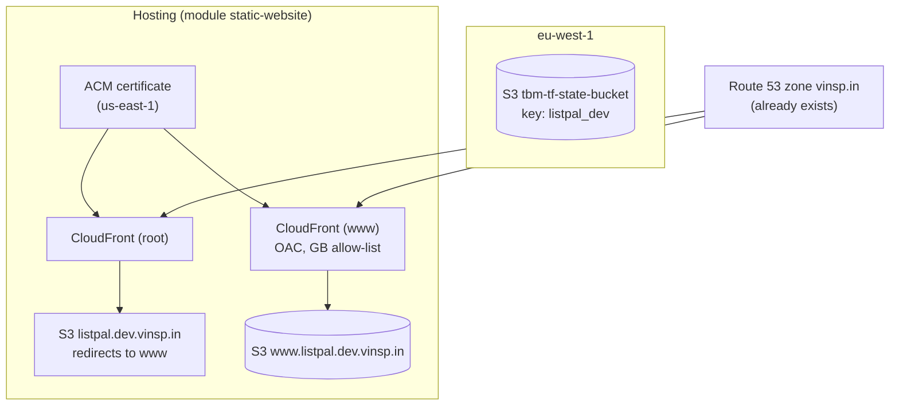

Key points:

- All infrastructure is one module call in `terraform/main.tf`: `static-website` from a private GitHub repository over SSH, pinned to `static-website-v0.0.15`.
- Project name `listpal-dev`, domain `listpal.dev.vinsp.in`, root zone `vinsp.in`, allowed locations `["GB"]`, query strings forwarded.
- Terraform state is in S3 bucket `tbm-tf-state-bucket` in `eu-west-1`, key `listpal_dev`. The backend uses a different key (`listpal-infra`) in the same bucket. No lock table is configured.
- Provider `hashicorp/aws ~> 5.35.0`, region `eu-west-2`. Required Terraform version `>= 0.14.0`.
- CloudFront maps a 403 from S3 to `/index.html` with status 200. This is what lets deep links such as `/board/<id>` work after a refresh.
- The S3 bucket is private and reached only through CloudFront origin access control.
- The root domain redirects to `www`.

## 11. Deployment and local development

There is no pipeline. Releases are run by hand with the `/deploy` skill in `.claude/skills/deploy/SKILL.md`. It builds a clean worktree of `origin/main`, syncs `dist/` to the bucket and invalidates CloudFront. It asks before each step that changes something. Getting a change onto `main` comes first and has its own skills: `/pr` (`.claude/skills/pr/SKILL.md`) raises a PR with a description written for later auditing and leaves it open, and `/merge` (`.claude/skills/merge/SKILL.md`) does the same and merges it. Neither one releases anything.

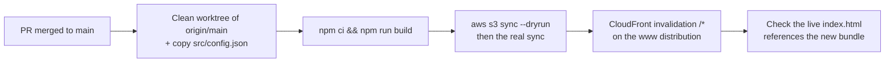

```sh
npm install
npm run dev        # Vite on 0.0.0.0:5173, uses localhost redirect URI
npm run build      # type-checks src/*.ts(x), then bundles to dist/
npm test           # Vitest
```

Things to know:

- `npm run deploy` still exists, but it builds the working tree and does not invalidate CloudFront. The cache TTL is one year, so use the deploy skill instead.
- Local dev signs in through the same Cognito pool and calls the same production API. Changes that write data affect the live Dev data.
- Terraform changes are applied from `terraform/` with `terraform plan` and `terraform apply`, using AWS credentials for the target account.

## 12. Persistence and recovery

The frontend has no backups of its own. Everything users care about is in the backend, so the backup and restore procedure is documented in `listpal-backend/ARCHITECTURE.md` (section 9).

Unsynced task edits and board settings are kept in the IndexedDB outbox across reloads, logouts and network failures, and are sent once the app is open and signed in again. They are lost only if the browser's site data is cleared, or if the server rejects them (for example, edits to a board that has since been deleted). That includes boards created while offline: the board and its tasks reach the server together once the app is back online.

`localStorage` and `sessionStorage` are cleared on logout, so the user has to sign in again. This also resets the sidebar and its Boards menu to closed.

## 13. Quality and security observations

These are things a reader should know before changing the app. They are not fixed in the code.

- **The API address is hard-coded.** `apiGatewayClient.js` sets `https://api.vinsp.in`. There is no way to point the app at a different API without editing source.
- **Tokens sit in `sessionStorage`.** Any script on the page can read them. The managed login URLs in `config.json` carry no `code_challenge`, so the code exchange is not PKCE-protected.
- **Failed saves aren't rolled back.** The theme is applied on screen before the API call. If the call fails, the alert says so, but the change stays on screen until a reload. Task sync is different: it retries and shows its state on the sync indicator, with no alert. The background refresh of a cached board is silent too, and keeps the cached copy.
- **Keepalive and CORS.** The `pagehide` flush is best effort. Browsers may refuse a keepalive request that needs a CORS preflight. Nothing is lost if it fails, because the outbox is flushed on the next load.
- **Old tabs block the database upgrade.** A tab still running a build from before the outbox (IndexedDB version 1) does not close its connection, so a new tab's upgrade waits until that tab is closed or reloaded.
- **Only `main.tsx` is type-checked.** The rest is JavaScript and `tsc` does not look at it, so `npm run build` gives little assurance about most of the code.
- **StrictMode is off.** `main.tsx` renders `<App />` without `<React.StrictMode>`, so React's development double-render checks do not run.
- **Reword sends task text to OpenAI.** The backend passes the task's text, its category and the board's name to OpenAI. The reply is shown only as a textarea's value, which React escapes; it must never be rendered as HTML or Markdown, as it is model output that a task's own text can steer.
- **Category sort.** `setOrderedSortedTasks` sorts by each category's first position in `CategoryOrder`. A category missing from that array ranks -1 and sorts to the top. The saved order can hold stale or missing names. So every category action (new, rename, delete, move) builds the new order from the categories on screen, passes it to `setSortedTasks` and saves it, which also repairs the saved order. A board whose saved order is stale can still load with the missing categories at the top, until one of those actions runs.

## 14. Where to look

| I want to... | Go to |
| --- | --- |
| Add a page or change routing | `src/App.jsx` (routes), `src/components/` |
| Add or change a backend call | `src/utils/apiGatewayClient.js`, then the caller in `src/components/` |
| Change Reword (menu item, lock, keep or revert, error messages) | `src/components/Task.jsx` (`handleReword`, `handleRevertReword`), `TaskMenu.jsx`, `Card.jsx` (`rewordTask`), `src/utils/apiErrors.js` (`CODED_ERRORS`), `rewordToApply` and `nextRewordChoice` in `utils.js`. The route itself is in `listpal-backend/src/reword.js` |
| Change the emoji a new category is given | `src/utils/categoryEmoji.js` (`CURATED_EMOJI`, `CATEGORY_STOPWORDS`, `suggestEmoji`) and its tests, called from `CardList.handleNewCard`. Keep the Welcome board's categories in `listpal-backend/src/welcome_board.js` in step with the map |
| Change how edits are queued or synced | `src/utils/syncEngine.js` (and its tests), and the write points in `Task.jsx`, `TaskMenu.jsx`, `CardList.jsx`, `Card.jsx`, `Board.jsx`, `DropdownMenu.jsx`, `TargetSetter.jsx`, `utils.js` (`saveBoardSettings`, `updateCategoryOrder`, `newTask`) |
| Change scoring or completion dates | `src/components/Card.jsx` (`toggleTaskChecked`), `src/utils/utils.js` (`getNextMondayAt5AM`, `periodsContaining`, `calcPercents`). Server-side score rules are in `listpal-backend/src/task_sync.js` and `score_periods.js` |
| Change sign-in, tokens or logout | `src/utils/authService.js`, `src/utils/utils.js` (`isTokenExpired`), `src/components/RedirectPage.jsx`, `src/config.json` |
| Add a theme | `src/App.css` (new `[data-theme]` block), `src/utils/themes.js` |
| Change hosting, domains or caching | `terraform/main.tf` (module inputs), `README.md` |
| Change the build or deploy | `package.json`, `vite.config.ts`, `tsconfig.json`, `.claude/skills/deploy/SKILL.md` |
| Change how PRs are raised or merged | `.claude/skills/pr/SKILL.md` (steps and description format), `.claude/skills/merge/SKILL.md` (merging and forcing) |
| Change when or how a page left open picks up changes from other devices | `src/utils/refreshOnReturn.js` (triggers and timings), `App.jsx` (boards), `Board.jsx` (tasks), `ScoreCounter.jsx` (no confetti for a refresh) |
| Change the API address or Cognito pool | `src/utils/apiGatewayClient.js`, `src/config.json` |
