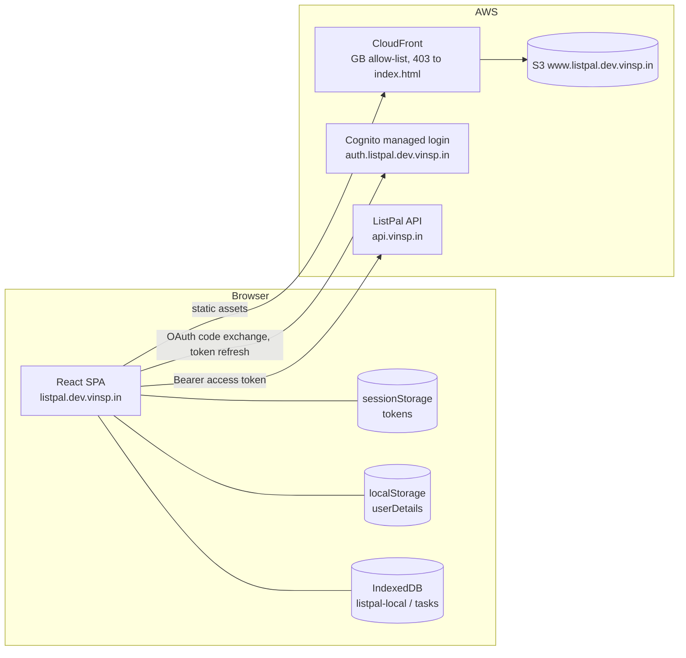
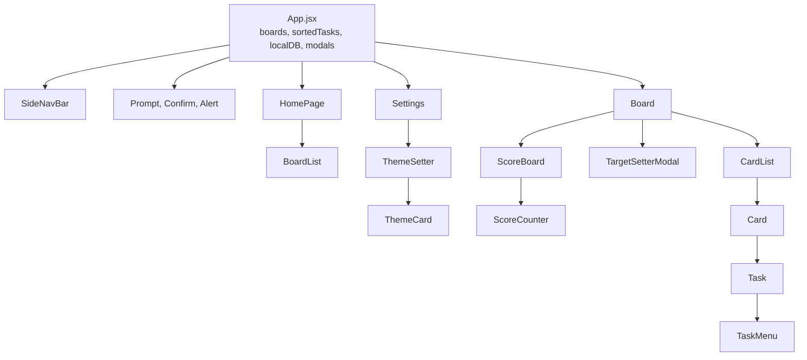
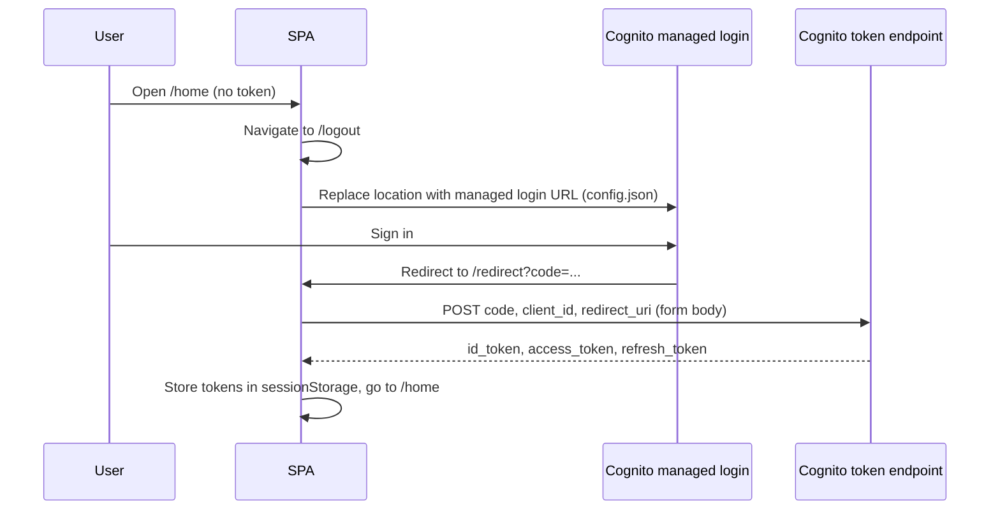
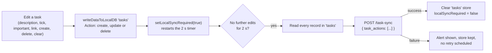
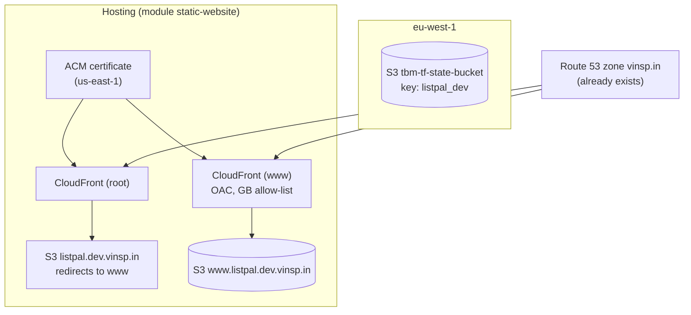
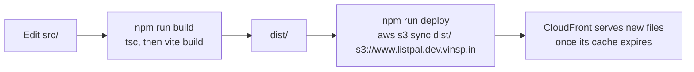

# ListPal Frontend: Architecture and Infrastructure

This document is a condensed map of the `listpal-frontend` repository. It is written so that a future reader (human or AI) can understand the app without reading every file. Facts were taken from the code on `main`. If the code has moved on, check the "Where to look" table before trusting the detail.

## 1. Summary

ListPal's frontend is a single-page React app. It shows a user's boards, lets them add and tick off tasks grouped by category, and displays scores against targets. The backend API is the source of truth. The app keeps a local queue of task edits in IndexedDB and pushes them to the backend about ten seconds after the last edit. It does not work offline.

| Concern | Choice |
| --- | --- |
| Language | JavaScript (JSX) with one TypeScript entry file (`src/main.tsx`) |
| UI | React 18, `react-dom/client` |
| Build | Vite 5, `@vitejs/plugin-react` |
| Routing | `react-router-dom` 6, `BrowserRouter`, all routes declared in `App.jsx` |
| HTTP | `axios` against `https://api.vinsp.in` (hard-coded in `apiGatewayClient.js`) |
| Auth | Cognito managed login (OAuth code flow), token refresh through `@aws-sdk/client-cognito-identity-provider` |
| Local queue | IndexedDB database `listpal-local`, object store `tasks` |
| Styling | Plain CSS, one file per component, theme colours as CSS custom properties |
| Charts | Victory (`victory`) |
| Hosting | S3 bucket `www.listpal.dev.vinsp.in` behind CloudFront, provisioned by Terraform |
| Environments | Effectively one. Local dev (`npm run dev`) talks to the same production API as the deployed site |

There is no test suite. `vitest` is listed in `devDependencies` but no test files exist and there is no test script.

## 2. Repository layout

```
listpal-frontend/
├── README.md                   Links only (Cognito, React libraries, CSS)
├── ARCHITECTURE.md             This file
├── index.html                  Vite entry; mounts #root and loads src/main.tsx
├── package.json                Scripts: dev, build, preview, deploy
├── vite.config.ts              React plugin only
├── tsconfig.json               Type-checks src/ (only .ts and .tsx files, no allowJs)
├── tsconfig.node.json          Covers vite.config.ts
├── public/                     Static files served as-is (favicon, icons)
├── src/
│   ├── main.tsx                ReactDOM.createRoot; StrictMode is commented out
│   ├── App.jsx                 Shell: routes, boards state, sync queue, modals, theme
│   ├── App.css                 Theme variables (:root) for four themes
│   ├── index.css               Global base styles and fonts (Circular)
│   ├── config.json             Region, Cognito pool and client IDs, login URLs
│   ├── fonts/                  Circular .otf files
│   ├── assets/                 PNG icons (icons8)
│   ├── utils/
│   │   ├── apiGatewayClient.js API wrapper: one function per backend route
│   │   ├── authService.js      Token exchange, refresh, storage of tokens
│   │   ├── localDBHelpers.js   IndexedDB helpers for the 'tasks' store
│   │   └── utils.js            JWT parsing, expiry check, percentages, dates, URL helpers
│   └── components/             Pages and widgets (one .jsx and usually one .css each)
├── terraform/
│   ├── main.tf                 The whole stack: one static-website module call
│   └── .terraform/             Provider and module cache (gitignored)
└── dist/                       Vite build output (gitignored)
```

`src/components/Header.jsx` is not rendered anywhere. `public/vite.svg`, `public/checked.svg` and `public/listpal-icon-bak.png` are not referenced from `src/` or `index.html`.

## 3. System architecture



The backend is described in `listpal-backend/ARCHITECTURE.md`. The frontend depends on it for every data read and write.

## 4. Pages and components

### 4.1 Routes

Routes are declared in `App.jsx`. The board route is a `/board/*` wildcard, and `getBoardIdFromUrl` in `utils.js` takes the board ID from the last URL segment. Every route except `/redirect` and `/logout` checks `isAuthenticated()` (which only tests that an access token is present in `sessionStorage`) and redirects to `/logout` when it is missing.

| Path | Component | Purpose | Backend calls |
| --- | --- | --- | --- |
| `/` | none | Redirects to `/home` | none |
| `/home` | `HomePage` | Greeting (from the ID token's `given_name`), week number, a random quote, the board list, and board creation | `POST /new-board` (via `BoardList`) |
| `/board/*` | `Board` | Tasks grouped by category, scores, targets, board emoji and name, delete, clear completed | `GET /active-tasks`, `POST /board-emoji`, `POST /rename-board`, `POST /delete-board`, `POST /board-targets` (via `TargetSetter`) |
| `/settings` | `Settings` | Theme choice | `POST /user-theme` (via `ThemeCard`) |
| `/redirect` | `RedirectPage` | Receives the Cognito `code`, exchanges it for tokens, then goes to `/home` | Cognito token endpoint |
| `/logout` | `Logout` | Clears storage and sends the user to the managed login | none |
| `*` | none | `/home` when signed in, `/logout` when not | none |

### 4.2 Component tree



`Board` and `CardList` receive `localDB`, `sortedTasks`, `setSortedTasks`, `setBoards` and the modal setters as props. Nothing uses React context.

## 5. Authentication and session



Points to know:

- The redirect URI is chosen by `isDev`, which App.jsx derives from `process.env.NODE_ENV`. Local dev returns to `http://localhost:5173/redirect`. Production returns to `https://listpal.dev.vinsp.in/redirect`. Both must be registered as Cognito callback URLs.
- Before every API call, `apiGatewayClient.js` checks the access token's `exp` claim. If it has passed, `authService.refreshTokens` calls `InitiateAuth` with `REFRESH_TOKEN_AUTH` directly from the browser. There are no AWS credentials involved.
- If the refresh fails, `sessionStorage` is cleared. The next render sees no token and routes to `/logout`.
- Logout clears both `localStorage` and `sessionStorage` and then replaces the location with the managed login URL.
- The `Authorization` header is `Bearer <accessToken>`. The ID token is only read locally, to show the user's first name.

## 6. Data and state

The frontend owns no durable data. Everything persistent lives in the backend. The browser holds four kinds of state.

| Store | Key or shape | Written by | Lifetime |
| --- | --- | --- | --- |
| React state in `App.jsx` | `boards`, `sortedTasks` (tasks grouped by category), `userDetails`, `localSyncRequired`, `localDB`, `activeBoard`, modal config | Pages through props | Until a reload |
| IndexedDB `listpal-local` / `tasks` | Task records with an `Action` field (`create`, `update` or `delete`), keyed on `SK` | `writeDataToLocalDB` in `localDBHelpers.js` | Until the next sync, but **cleared on every page load** (see section 13) |
| `sessionStorage` | `idToken`, `accessToken`, `refreshToken` | `authService.js` | Browser session |
| `localStorage` | `userDetails` (user record, mostly for the theme) | `App.jsx` after loading, `ThemeCard` on change | Until logout |

`App.jsx` loads the user and the boards on start-up with `Promise.all([getUser(), getBoards()])`. It parses `CategoryOrder` from a JSON string into an array for each board. Board pages then load their tasks separately with `getActiveTasks(boardID)`.

## 7. Task writes and sync

Most task edits do not call the API directly. They are written to IndexedDB first and then pushed in one batch to `POST /task-sync`.



How the queue works:

- `setLocalSyncRequiredWrapper` in `App.jsx` flips a counter each time it is called. The timer effect depends on that counter, so every edit restarts the 2-second wait (`SYNC_TIMEOUT`).
- When an existing task is edited, `Task.jsx`, `TaskMenu.jsx` and `CardList.jsx` read the record first. If it is already `create`, the action stays `create`. Otherwise it becomes `update`. This means a task created and edited before a sync is only ever sent as a create.
- Deleting a task that was never synced removes its record. Deleting a synced task writes `{ Action: "delete", SK }`.
- `beforeunload` shows a warning while `localSyncRequired` is true.

Edits that bypass the queue and call the API straight away:

| Action | Where | Endpoint |
| --- | --- | --- |
| Tick or untick a task, update board scores | `Task.jsx` (`updateActiveTaskChecked`) | `POST /board-scores` |
| Rename a category | `Card.jsx` | `POST /rename-category` |
| Change a task's emoji for a whole category | `Card.jsx` | `POST /card-emoji` |
| Save category order | `DropdownMenu.jsx` (move up or down), `utils.js` (`updateCategoryOrder`, called from `Card.jsx` and `CardList.jsx`) | `POST /board-category-order` |
| Create, rename, change emoji, delete a board | `BoardList.jsx`, `Board.jsx` | `POST /new-board`, `/rename-board`, `/board-emoji`, `/delete-board` |
| Save targets | `TargetSetter.jsx` | `POST /board-targets` |
| Save theme | `ThemeCard.jsx` | `POST /user-theme` |

Board score changes are applied to React state and sent straight away, so they are not covered by the sync queue.

## 8. API client

`src/utils/apiGatewayClient.js` is the only place that builds URLs. Each exported function maps to one backend route.

| Function | Method and path | Backend status |
| --- | --- | --- |
| `getBoards` | `GET /boards` | Present |
| `getUser` | `GET /user` | Present |
| `getActiveTasks` | `GET /active-tasks` | Present |
| `syncTasks` | `POST /task-sync` | Present |
| `updateTaskEmojiAPI` | `POST /card-emoji` | Present |
| `updateThemeAPI` | `POST /user-theme` | Present |
| `newBoardAPI` | `POST /new-board` | Present |
| `renameBoardAPI` | `POST /rename-board` | Present |
| `updateBoardEmojiAPI` | `POST /board-emoji` | Present |
| `updateBoardCategoryOrder` | `POST /board-category-order` | Present |
| `deleteBoard` | `POST /delete-board` | Present |
| `renameCategoryAPI` | `POST /rename-category` | Present |
| `updateBoardScoresAPI` | `POST /board-scores` | Present |
| `updateBoardTargetsAPI` | `POST /board-targets` | Present |

Failures are handled the same way for every call. `apiGet` and `apiPost` log the error, call `window.alert(...)` and rethrow. A failed token refresh returns `undefined` without throwing, so callers receive an empty value.

## 9. Styling and theming

- Each component imports its own CSS file. There is no CSS-in-JS, although `@emotion/react` is installed.
- `App.css` defines four themes on `:root`: `purple-haze` (the default), `granite`, `aqua-mentos` and `cherry-violet`. Each sets `-bg`, `-fg`, `-text-colour`, `-accent` and `-accent-2`.
- `applyTheme` in `App.jsx` copies the user's theme into the generic variables `--background`, `--foreground`, `--text-colour`, `--accent` and `--accent-2` on `document.documentElement`. Components read the generic names.
- `App.css` sets `color-scheme: dark`. `index.css` has a light-scheme media query that only changes text colour.
- Fonts are the Circular family from `src/fonts/`, loaded with `@font-face` in `index.css`.
- Layout is responsive. `App.jsx` treats a window narrower than 650 px as mobile (`MOBILE_BREAKPOINT`), and the side bar behaves differently in that mode.

## 10. Infrastructure



Key points:

- All infrastructure is one module call in `terraform/main.tf`: `static-website` from a private GitHub repository over SSH, pinned to `static-website-v0.0.15`.
- Project name `listpal-dev`, domain `listpal.dev.vinsp.in`, root zone `vinsp.in`, allowed locations `["GB"]`, query strings forwarded.
- Terraform state is in S3 bucket `tbm-tf-state-bucket` in `eu-west-1`, key `listpal_dev`. The backend uses a different key (`listpal-infra`) in the same bucket. No lock table is configured.
- Provider `hashicorp/aws ~> 5.35.0`, region `eu-west-2`. Required Terraform version `>= 0.14.0`.
- CloudFront maps a 403 from S3 to `/index.html` with status 200. This is what lets deep links such as `/board/<id>` work after a refresh.
- The S3 bucket is private and reached only through CloudFront origin access control.
- The root domain redirects to `www`.

## 11. Deployment and local development

There is no pipeline. Deployment is run by hand.



```sh
npm install
npm run dev        # Vite on 0.0.0.0:5173, uses localhost redirect URI
npm run build      # type-checks src/*.ts(x), then bundles to dist/
npm run deploy     # build, then sync dist/ to the www bucket
```

Things to know:

- `npm run deploy` does not invalidate CloudFront. Users may see the old `index.html` until the cache expires.
- Local dev signs in through the same Cognito pool and calls the same production API. Changes that write data affect the live Dev data.
- Terraform changes are applied from `terraform/` with `terraform plan` and `terraform apply`, using AWS credentials for the target account.

## 12. Persistence and recovery

The frontend has no backups of its own. Everything users care about is in the backend, so the backup and restore procedure is documented in `listpal-backend/ARCHITECTURE.md` (section 9).

Two client-side losses are possible:

- Task edits that have not synced yet are lost if the page is reloaded. The load code clears the `tasks` store (section 13).
- `localStorage` and `sessionStorage` are cleared on logout, so the user has to sign in again.

## 13. Quality and security observations

These are things a reader should know before changing the app. They are not fixed in the code.

- **Unsynced task edits are discarded on reload.** `App.jsx` clears the IndexedDB `tasks` store every time the page loads (`initDB`). The `beforeunload` warning only asks the user to confirm.
- **A failed sync is not retried.** `syncInterval` shows "will retry..." but schedules nothing. The timer only restarts when another edit happens, and the pending records stay in IndexedDB until then.
- **Board score changes are not queued.** `Task.jsx` updates the score in React state and calls `updateBoardScoresAPI` without awaiting it, from inside a `setBoards` updater. A failed call leaves the screen and the server out of step, and the error becomes an unhandled promise rejection.
- **Broken error handler in `Board.jsx`.** In `getTasks`, the `catch` calls `setAlertConf({...}).finally(...)`. `setAlertConf` returns `undefined`, so the `.finally` call throws.
- **Silent failure on token refresh.** `tokenCheck` returns `false`, and `apiGet` and `apiPost` then return `undefined`. `loadInitialData` and the board pages then fail later on `undefined.map` or similar.
- **The API address is hard-coded.** `apiGatewayClient.js` sets `https://api.vinsp.in`. There is no way to point the app at a different API without editing source.
- **Tokens sit in `sessionStorage`.** Any script on the page can read them. The managed login URLs in `config.json` carry no `code_challenge`, so the code exchange is not PKCE-protected.
- **Dialogs for errors.** `apiGet` and `apiPost` call `window.alert`, which blocks the page.
- **Only `main.tsx` is type-checked.** The rest is JavaScript and `tsc` does not look at it, so `npm run build` gives little assurance about most of the code.
- **StrictMode is off.** `main.tsx` has `<React.StrictMode>` commented out, so React's development double-render checks do not run.
- **Unused dependencies.** `react-select`, `react-dropdown` and `@emotion/react` are not imported anywhere. `vitest` has no tests.
- **Category sort.** `setOrderedSortedTasks` sorts by `indexOf` in `CategoryOrder`. A category missing from that array gets index -1 and sorts to the top.
- **Unused component and assets.** `Header.jsx` is not rendered. Several files in `public/` are not referenced.

## 14. Where to look

| I want to... | Go to |
| --- | --- |
| Add a page or change routing | `src/App.jsx` (routes), `src/components/` |
| Add or change a backend call | `src/utils/apiGatewayClient.js`, then the caller in `src/components/` |
| Change how edits are queued or synced | `src/App.jsx` (`syncInterval`, `setLocalSyncRequiredWrapper`), `src/utils/localDBHelpers.js`, and the write points in `Task.jsx`, `TaskMenu.jsx`, `CardList.jsx`, `Card.jsx`, `Board.jsx` |
| Change scoring or completion dates | `src/components/Task.jsx` (`updateActiveTaskChecked`), `src/utils/utils.js` (`getNextMondayAt5AM`, `calcPercents`) |
| Change sign-in, tokens or logout | `src/utils/authService.js`, `src/utils/utils.js` (`isTokenExpired`), `src/components/RedirectPage.jsx`, `src/config.json` |
| Add a theme | `src/App.css` (new `:root` block), `src/components/ThemeSetter.jsx`, `src/components/ThemeCard.jsx` (`THEME_NAMES`) |
| Change hosting, domains or caching | `terraform/main.tf` (module inputs), `README.md` |
| Change the build or deploy | `package.json`, `vite.config.ts`, `tsconfig.json` |
| Change the API address or Cognito pool | `src/utils/apiGatewayClient.js`, `src/config.json` |
